# Documentação do Projeto — Dropdown Table Widget (SAP Analytics Cloud)

> Versão documentada: **v2.14.0** (tag `v2.14.0`, `main` em `0893942`).
> Base: código real do repositório (`dropdown-table-widget-v2.js`, `style-panel.js`, `dropdowntable.json`, `tools/`, `test/`) e `README.md`.
> As referências de linha (`#Lnnn`) valem para a v2.14.0 e mudam com o tempo: procure sempre pelo **nome da função**.

## Convenções desta documentação

| Marcação | Significado |
|---|---|
| **Fato** (sem marcação) | Está explícito no código ou no JSON do widget. |
| 📄 **README** | Está no `README.md` (scripts de exemplo da story), não no código do widget. |
| 💬 **Informado em sessão** | Foi informado pelo responsável durante o desenvolvimento; não aparece no código. |
| 🔎 **Inferência** | Interpretação a partir do código; precisa ser confirmada. |
| **Não identificado no código analisado.** | Não é possível determinar a partir do projeto. |

---

## Visão executiva

| Item | Resumo |
|---|---|
| **Projeto** | Dropdown Table Widget (`id: dropdowntable`, versão 2.14.0) |
| **Objetivo** | Permitir o planejamento de despesas por conta numa tabela em que as dimensões de cada linha (ex.: Periodicidade, Fonte da Informação, Responsabilidade) são escolhidas numa **lista suspensa**, como a validação de dados do Excel, e as medidas são digitadas na própria tabela. |
| **Tecnologia** | Custom Widget do SAP Analytics Cloud (Web Component em JavaScript puro, Shadow DOM, sem bibliotecas). Painel de estilo próprio. Contrato SAC em JSON. Ferramentas de release e testes em Node.js. |
| **Componentes principais** | 1) Widget `dropdown-table-widget-v2.js` (tabela, regras, lista de gravação). 2) Painel `style-panel.js` (cores, dropdowns, regras de gravação). 3) Contrato `dropdowntable.json` (propriedades, métodos, eventos, bindings). 4) Scripts da story (salvar, criar/excluir membro). 5) Ferramentas `tools/` e testes `test/`. |
| **Fluxo resumido** | O SAC entrega os dados (bindings) → o widget monta as linhas (uma por conta), descobre o valor gravado de cada dimensão e as opções das listas → o usuário troca dimensões e digita valores → o widget registra alterações pendentes e aplica as regras → ao clicar em **Salvar**, o script da story pede ao widget a lista de gravação e chama `setUserInput` + `submitData` numa Tabela de planejamento → o widget limpa as pendências (ou mantém as que falharam). |
| **Principais regras** | Membro padrão **NÃO APLICAVEL** em células sem valor; Responsabilidade **CLIENTE** grava 0 e trava as medidas; todas as dimensões em NÃO APLICÁVEL bloqueiam as medidas; trocar a combinação **move** o valor (zera a antiga); célula apagada grava **0**; falhas continuam pendentes; troca de contexto descarta pendências com aviso; exclusão de conta com valor é bloqueada. |
| **Pontos críticos** | A gravação depende de uma **Tabela de planejamento na story** filtrada no mesmo contexto do widget; IDs e hierarquias das dimensões (`writeHierarchies`); nomes `RESPONSABILIDADE`/`CLIENTE` e `NÃO APLICAVEL` como regras padrão; integridade (hash) do JSON na publicação; formato de endereço com separadores `\|~\|`, `\|\|\|`, `§`, `###`. |
| **Dependências** | SAC (API de Custom Widget, bindings, `getMembers`), API de planejamento da Tabela (`setUserInput`, `submitData`) e do modelo (`createMembers`, `deleteMembers`) nos scripts da story. Hospedagem dos arquivos: jsDelivr (tag fixa) ou pacote JSON + zip hospedado no próprio SAC. |
| **Status** | Em produção na v2.14.0. 71 testes automáticos passando (harness no navegador) e teste de convivência PROD + DEV. |

---

## Sumário

1. [Visão Geral](#1-visão-geral)
2. [Objetivo](#2-objetivo)
3. [Arquitetura](#3-arquitetura)
4. [Fluxo Principal](#4-fluxo-principal)
5. [Fluxogramas](#5-fluxogramas)
6. [Fluxo de Dados](#6-fluxo-de-dados)
7. [Componentes](#7-componentes)
8. [Scripts](#8-scripts)
9. [Funções](#9-funções)
10. [Regras de Negócio](#10-regras-de-negócio)
11. [Modelos](#11-modelos)
12. [Dimensões](#12-dimensões)
13. [Medidas](#13-medidas)
14. [Widgets](#14-widgets)
15. [Data Actions](#15-data-actions)
16. [Dependências](#16-dependências)
17. [Pontos Críticos](#17-pontos-críticos)
18. [Troubleshooting](#18-troubleshooting)
19. [Manutenção](#19-manutenção)
20. [Matriz de Impacto](#20-matriz-de-impacto)
21. [Guia para Novos Desenvolvedores](#21-guia-para-novos-desenvolvedores)
22. [Considerações Técnicas](#22-considerações-técnicas)
23. [Glossário](#23-glossário)

---

## 1. Visão Geral

O projeto é um **Custom Widget do SAP Analytics Cloud** que substitui, para o planejamento de despesas por conta, a combinação "tabela do SAC + scripts que carregam dimensões". Ele mostra uma tabela em que:

- cada **linha** é uma conta (`dimensions_0` do binding — no modelo, a dimensão de conta; o README usa `DESCRICAO_DA_CONTA`);
- as demais **dimensões da linha** aparecem como **listas suspensas** (dropdowns) com os membros possíveis;
- as **medidas** aparecem como campos editáveis;
- contas-pai aparecem como **títulos de grupo** e **subgrupo**; grupos de "netos" podem virar **uma linha com seletor**.

O widget **não grava sozinho no modelo**: a API de Custom Widget do SAC não oferece escrita em modelos de planejamento. Por isso, ele monta uma **lista de gravação pronta** e a story executa um script curto que chama `Table.getPlanning().setUserInput()` e `submitData()` numa Tabela de planejamento (📄 README).

### Arquivos do repositório

| Arquivo | Papel | Observação |
|---|---|---|
| `dropdown-table-widget-v2.js` | Widget principal (Web Component `dropdowntable-widget`). | ~3.350 linhas. Contém CSS, HTML do template, regras e renderização. |
| `style-panel.js` | Painel de estilo/configuração (Web Component `dropdowntable-styling`). | Publica `styleConfig` e propriedades de cor. |
| `dropdowntable.json` | Contrato do widget de **produção** (propriedades, métodos, eventos, bindings, URLs e hashes). | Importado no SAC. |
| `dropdowntable-dev.json` | Contrato do widget **DEV** (`id: dropdowntable_dev`, tags `-dev`). | Gerado por `tools/release-dev.js`. |
| `releases/dropdowntable-v2.11.25.json` | Contrato da versão anterior (rollback), apontando para jsDelivr na tag `v2.11.25`. | — |
| `releases/dropdowntable-v2.14.0.json` | Cópia do contrato de produção v2.14.0. | — |
| `tools/lib.js` | Funções comuns de release (git, hash SRI, URL do CDN, conferência). | — |
| `tools/release-dev.js` | Gera o JSON DEV apontando para o commit atual (jsDelivr). | — |
| `tools/release-prod.js` | Gera o JSON de produção apontando para uma tag (jsDelivr). | — |
| `tools/release-sac.js` | Gera **JSON + zip** para hospedar o widget no próprio SAC. | Presente na pasta; **ainda não versionado** no momento desta documentação. Saída em `dist/` (ignorada pelo git). |
| `test/server.js` | Servidor local de testes (porta 5180). | — |
| `test/harness.html` | 71 testes automáticos no navegador. | — |
| `test/mock-binding.js` | Simula os bindings e a DataSource do SAC. | Dados fictícios (C1, C2, Ana, Bruno, QTDE, CUSTO). |
| `test/coexist.html` | Verifica PROD + DEV carregados na mesma página. | — |
| `README.md` | Configuração, scripts da story e processo de release. | — |

> Na pasta pai (`Documentos_CAP/files/`) existem `dropdown-table-widget.js`, `dropdowntable.json` (v2.5.2, apontando para GitHub Pages) e `style-panel.js`. São **versões antigas fora do repositório** e não fazem parte da solução atual.

---

## 2. Objetivo

### Problema que resolve
🔎 **Inferência (apoiada no código e no README):** na tabela padrão do SAC, informar a combinação de dimensões de uma conta (Periodicidade, Fonte, Responsabilidade) exige abrir hierarquias e cruzar membros. Antes deste widget, a story precisava de scripts para carregar os valores atuais (`setRowValues`), as opções (`setDropdownOptions`) e de uma "tabela espelho". O widget concentra isso numa tabela com listas de seleção e regras embutidas.

### Por que existe
- Tornar o preenchimento **parecido com a validação de dados do Excel** (comentário do topo do arquivo e README).
- Retirar da story a lógica de negócio (carregar dimensões, regras de gravação, validação de membros) e deixar só o mínimo que a API do SAC exige em script.

### Processo automatizado
1. Descobrir, por conta, qual combinação de dimensões já está gravada.
2. Montar as opções de cada lista.
3. Registrar trocas de combinação e valores digitados.
4. Aplicar as regras (CLIENTE = 0, bloqueios, mover valores, zerar combinação antiga).
5. Montar a lista de gravação para o `setUserInput`.
6. Validar a criação e a exclusão de contas.

### Quem utiliza
- **Usuários de planejamento** que preenchem despesas por conta e cliente na story.
- **Desenvolvedores SAC** que configuram bindings, painel e scripts.
- 💬 **Informado em sessão:** o cliente é escolhido por um **Input Control** da story; o contexto (Version/Date) é filtrado no binding e na tabela de gravação.

### Resultado esperado
Valores gravados no modelo de planejamento na combinação de dimensões correta, sem duplicar combinações por conta, com as regras de Responsabilidade e "não aplicável" respeitadas.

---

## 3. Arquitetura

### 3.1 Componentes e responsabilidades

| Componente | Responsabilidade | Onde |
|---|---|---|
| **Widget** (`DropdownTableWidget`) | Ler bindings, montar linhas e listas, controlar edição, aplicar regras, montar a lista de gravação, validar membros, avisos. | `dropdown-table-widget-v2.js` |
| **Painel** (`DropdownTableStyling`) | Editar cores, fonte, altura, alinhamento, título, botão Salvar, dimensões de dropdown, valor padrão, regras de gravação, modo diagnóstico. | `style-panel.js` |
| **Contrato** | Declarar ao SAC propriedades, métodos chamáveis por script, eventos e bindings. | `dropdowntable.json` |
| **Bindings do SAC** | Entregar os dados: `myDataBinding` (linhas), `childrenBinding` (opções), `valuesBinding` (combinação gravada), `dataSource` (compatibilidade). | Builder do widget na story |
| **DataSource** (`getMembers`) | Lista completa de membros de cada dimensão (opções). | API `this.dataBindings` |
| **Scripts da story** | `onSaveRequested` (gravar), `onAddMemberRequested` (criar membro), `onDeleteMemberRequested` (excluir membro). | Story (📄 README) |
| **Tabela de planejamento** | Executa `setUserInput`/`submitData`. | Story (📄 README: `Table_1`) |
| **Modelo de planejamento** | Recebe os valores; `createMembers`/`deleteMembers`. | 📄 README: `MODEL_CAP_DESPESAS` |
| **Ferramentas** | Gerar JSONs com URL e hash; empacotar para o SAC. | `tools/` |
| **Testes** | Simular o SAC e validar regras. | `test/` |

### 3.2 Diagrama de arquitetura

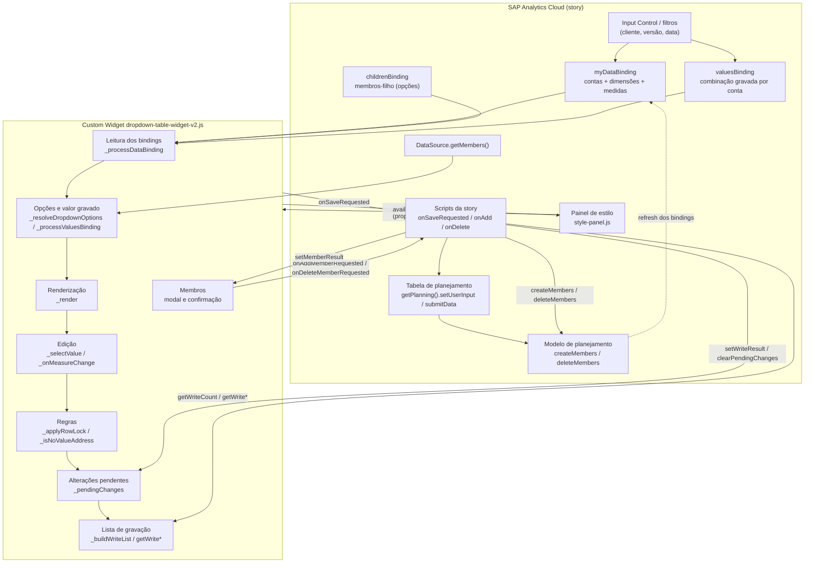

### 3.3 Fluxo real de alto nível

```text
SAC entrega bindings (onCustomWidgetAfterUpdate)
        ↓
_processDataBinding: detecta troca de contexto (_fingerprint) → descarta pendências se necessário
        ↓
Indexa nós/folhas, lê childrenBinding e valuesBinding, publica availableDimensions
        ↓
_render: escolhe 1 linha por conta, grupos/subgrupos/netos, monta dropdowns e inputs, aplica bloqueios
        ↓  (assíncrono) _loadDataSourceMembers → getMembers() → _render de novo
Usuário troca dropdown (_selectValue) ou digita medida (_onMeasureChange)
        ↓
Regras: _registerDropdownMove (move/zera), _applyRowLock (CLIENTE / tudo NÃO APLICÁVEL)
        ↓
_addPendingChange → propertiesChanged (pendingChanges, measureChange*) → eventos onDropdownChanged / onMeasureChanged
        ↓
Botão Salvar (_bindSaveButton) → onSaveRequested
        ↓
Script da story: getWriteCount (_buildWriteList) → setUserInput × N → setWriteResult → submitData → clearPendingChanges
        ↓
clearPendingChanges: mantém só falhas, marca seleções como salvas, abre janela pós-save
        ↓
SAC atualiza bindings → _processDataBinding (dentro da janela: sem descarte) → _render com os valores do modelo
```

---

## 4. Fluxo Principal

O fluxo principal tem quatro processos independentes, detalhados na seção 5:

| # | Processo | Evento que inicia | Função de entrada |
|---|---|---|---|
| A | Carregar e desenhar a tabela | SAC chama `onCustomWidgetReady` / `onCustomWidgetAfterUpdate` | `_loadBinding` / `_processDataBinding` |
| B | Trocar uma dimensão | Clique num item da lista (`mousedown`) | `_selectValue` |
| C | Digitar uma medida | `change` do input de medida | `_onMeasureChange` |
| D | Salvar | Clique em **Salvar** | `_bindSaveButton` → script `onSaveRequested` |
| E | Adicionar membro | Menu de contexto → **Adicionar membro** | `_openAddMemberModal` → `_bindModal` |
| F | Excluir membro | Menu de contexto → **Excluir membro** | `_openDeleteConfirm` → `_bindDeleteConfirm` |
| G | Configurar pelo painel | **Aplicar** no painel | `DropdownTableStyling._submit` → `applyStyleConfig` |

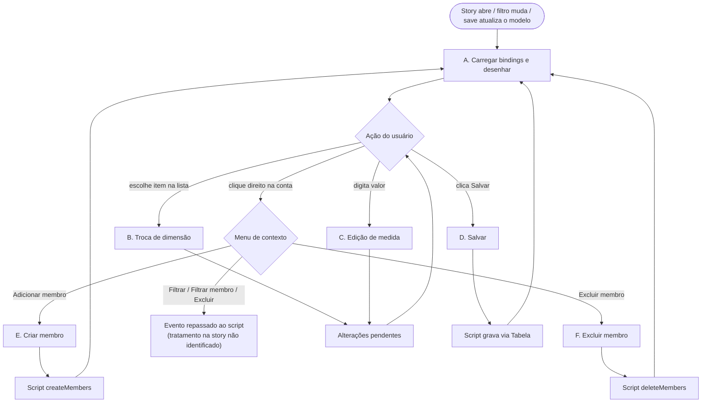

---

## 5. Fluxogramas

### 5.1 Fluxo A — Carregamento e renderização

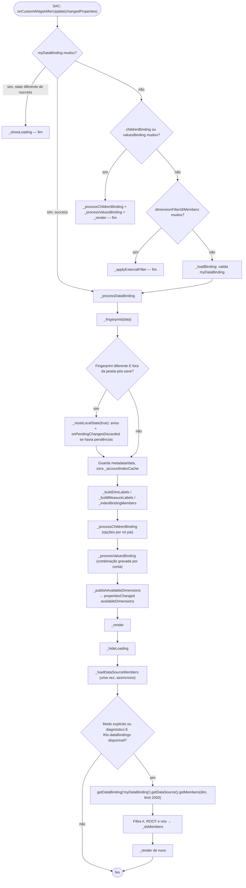

### 5.2 `_render` — montagem da tabela

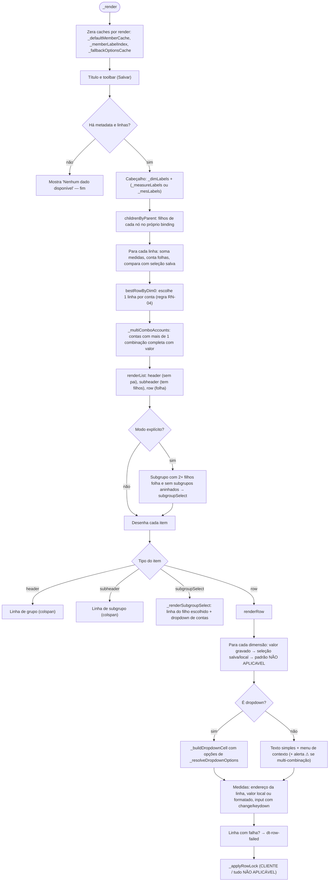

### 5.3 Valor exibido numa célula de dimensão (modo explícito)

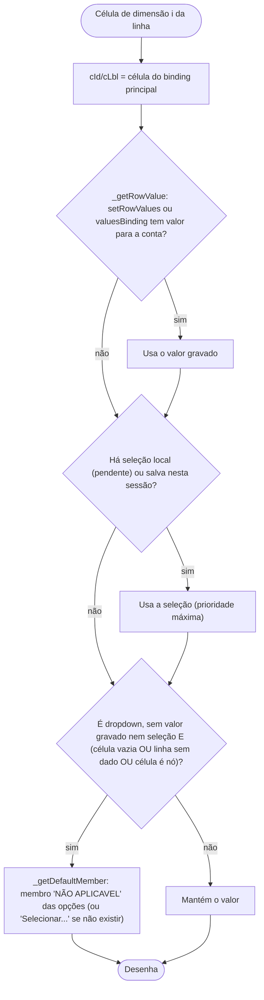

### 5.4 Resolução das opções da lista (`_resolveDropdownOptions`)

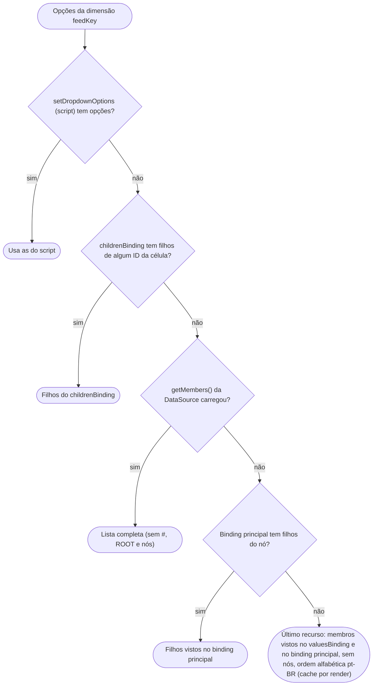

### 5.5 Fluxo B — Troca de dimensão

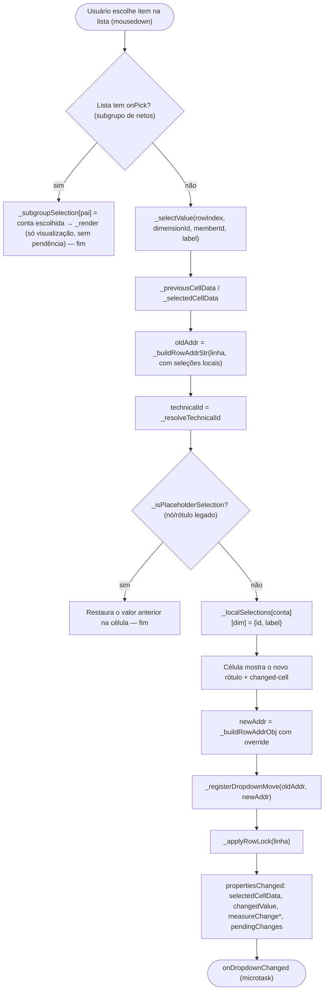

### 5.6 `_registerDropdownMove` — mover valores na troca de combinação

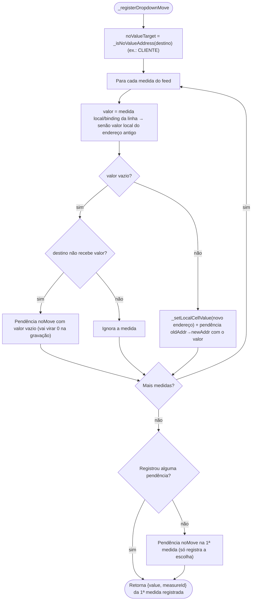

### 5.7 Fluxo C — Edição de medida

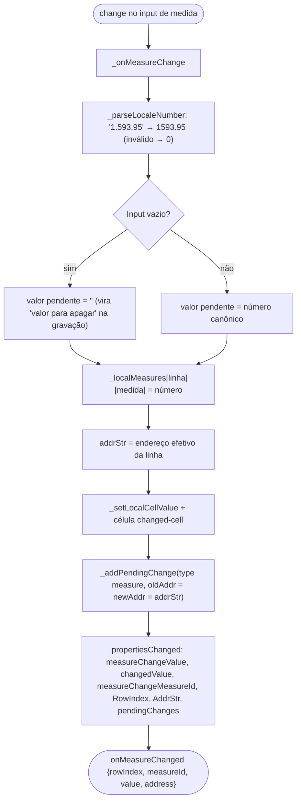

### 5.8 Fluxo D — Salvar (sequência completa)

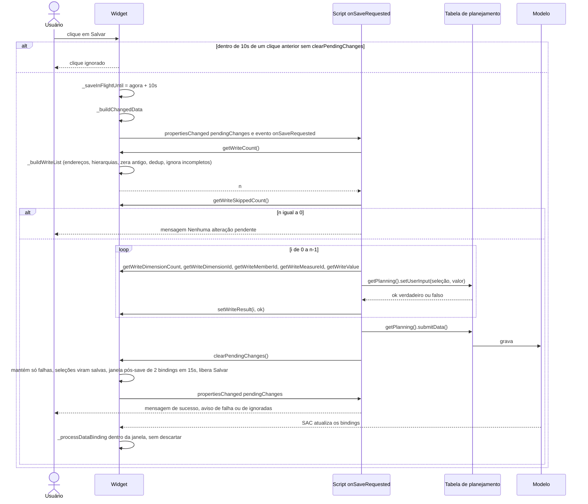

### 5.9 `_buildWriteList` — lista de gravação

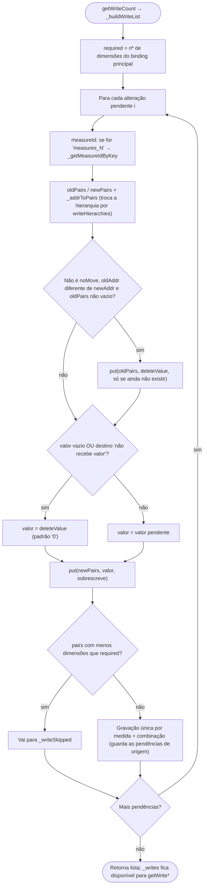

### 5.10 `clearPendingChanges` — pós-gravação

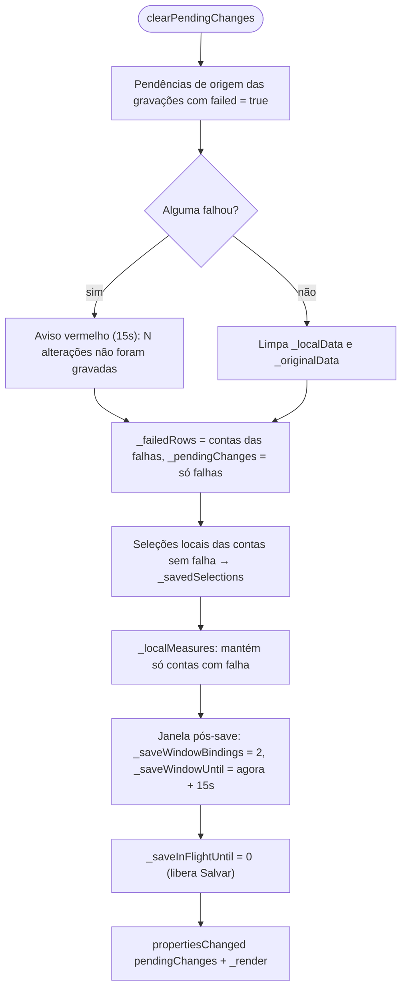

### 5.11 Bloqueio da linha (`_getRowLockState` / `_applyRowLock`)

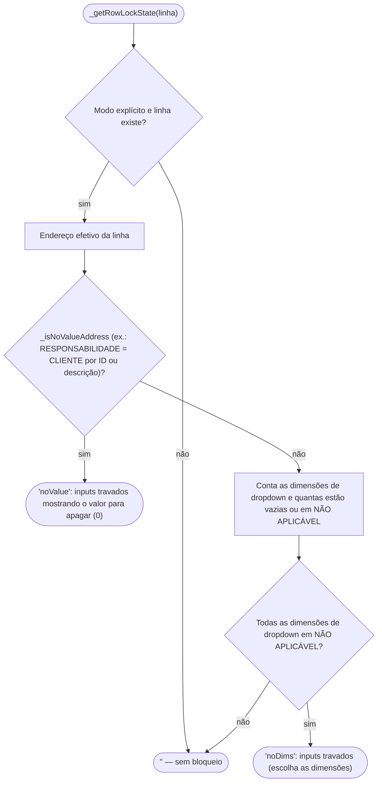

### 5.12 Fluxo E — Adicionar membro

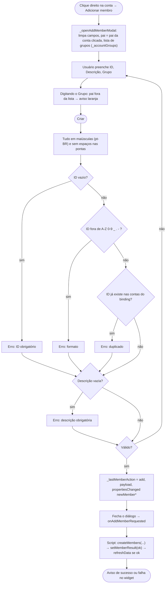

### 5.13 Fluxo F — Excluir membro

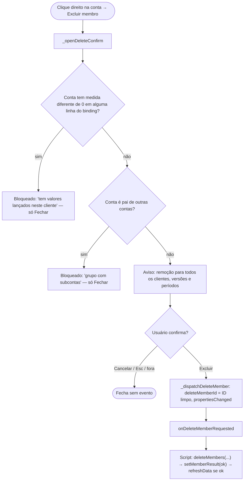

### 5.14 Troca de contexto (cliente/filtro) com alterações pendentes

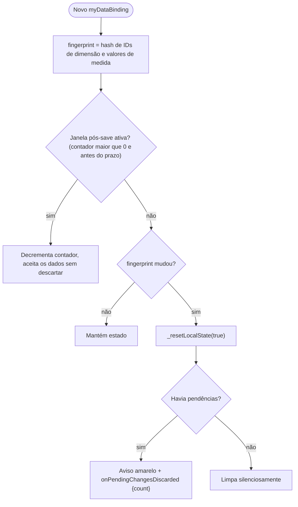

### 5.15 Fluxo G — Configuração pelo painel

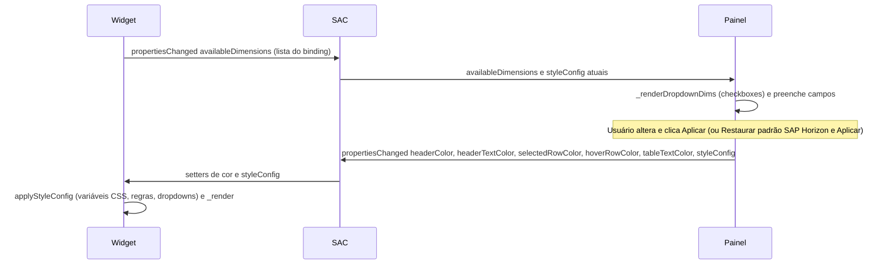

---

## 6. Fluxo de Dados

### 6.1 Visão geral

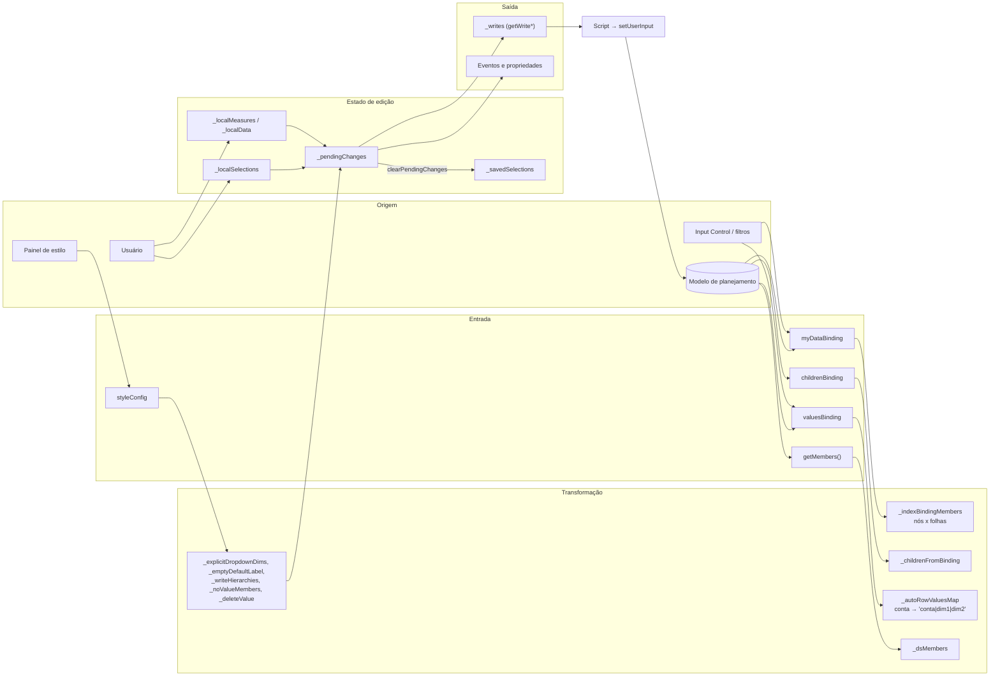

### 6.2 Caminho de um valor (do modelo à tela e de volta)

```text
Origem: modelo de planejamento (filtrado por cliente/versão/data na story)
  ↓
Entrada: myDataBinding.data[r].measures_N {raw, formattedValue}
         valuesBinding.data (conta + dimensões folha + medida)
  ↓
Validação: _rowHasData (medida numérica?), _isNodeId (nó de hierarquia?), "#" (não atribuído) descartado
  ↓
Transformação: _processValuesBinding → combinação de maior soma absoluta por conta
               _formatMeasureCell → texto exibido (sem sufixo de moeda)
  ↓
Processamento (edição): _parseLocaleNumber ("1.593,95" → 1593.95) → _localMeasures / _localData
                        _addPendingChange (encadeia A→B→C, uma pendência por medida/endereço)
  ↓
Persistência: _buildWriteList → pares {dimensão, membro} + medida + valor
              script: Table.getPlanning().setUserInput(sel, valor) → submitData()
  ↓
Destino: modelo de planejamento → SAC atualiza os bindings → widget redesenha
```

### 6.3 Estruturas de dados internas

| Estrutura | Formato | Escrita por | Lida por |
|---|---|---|---|
| Endereço (objeto) | `{ "DESCRICAO_DA_CONTA": "[...].&[C1]", "PERIODICIDADE": "[...].&[MENSAL]", ... }` | `_buildRowAddrObj` | `_serializeAddrObj`, `_getRowLockState`, `_buildChangedData` |
| Endereço (texto) | `DIM\|~\|MEMBRO\|\|\|DIM\|~\|MEMBRO\|\|\|` | `_serializeAddrObj` | `_addrToPairs`, `pendingChanges` |
| Alteração pendente | `{type: "measure"\|"dropdown", rowIndex, oldAddr, newAddr, value, measureId, noMove?}` | `_addPendingChange` | `_buildWriteList`, `clearPendingChanges` |
| `pendingChanges` (propriedade) | `oldAddr§newAddr§valor§medida###...` | `_serializePendingChanges` | Script (`getPendingChanges`), diagnóstico |
| Gravação | `{pairs: [{dim, member}], measureId, value, sources: [i], failed}` | `_buildWriteList` | `getWrite*`, `setWriteResult`, `clearPendingChanges` |
| `_autoRowValuesMap` | `{ "<id conta>": "conta\|dim1\|dim2", "<id limpo>": ... }` | `_processValuesBinding` | `_getRowValuesString` |
| `_localSelections` / `_savedSelections` | `{ "<id conta>": { "dimensions_N": {id, label} } }` | `_selectValue` / `clearPendingChanges` | `_buildRowAddrObj`, `_render` |
| `_localMeasures` | `{ rowIndex: { "measures_N": número } }` | `_onMeasureChange` | `_getRowMeasureValue`, `_buildChangedData` |
| `_localData` / `_originalData` | `{ "<addrStr>___<medida>": {value} \| valor }` | `_setLocalCellValue` / `_render` | `_render`, `_getCurrentLocalValue` |
| `styleConfig` | JSON com cores, fonte, `dropdownDimensions`, `emptyDefaultLabel`, `writeHierarchies`, `noValueMembers`, `deleteValue`, `debugMode` | Painel `_submit` | `applyStyleConfig` |

> **Separadores reservados:** `|~|`, `|||`, `§`, `###` e `|` (no mapa de valores). Se um ID de membro contiver algum deles, o endereço quebra (ver Pontos Críticos).

---

## 7. Componentes

### 7.1 Widget — `DropdownTableWidget` (`dropdown-table-widget-v2.js`)

- **Responsabilidade:** toda a lógica de tela, regras e preparação da gravação.
- **Quando é executado:** criado pelo SAC ao abrir a story; reage a `onCustomWidgetReady`, `onCustomWidgetAfterUpdate`, `onCustomWidgetResize`, `onCustomWidgetDestroy`, eventos de usuário e chamadas de método pelo script.
- **Entradas:** bindings (`myDataBinding`, `childrenBinding`, `valuesBinding`), `this.dataBindings` (DataSource), propriedades (`styleConfig`, cores, `rowHeight`...), métodos chamados pelo script.
- **Processamento:** seções 5 e 9.
- **Saídas:** DOM da tabela; eventos (`onSaveRequested`, `onDropdownChanged`, `onMeasureChanged`, `onAddMemberRequested`, `onDeleteMemberRequested`, `onFilterMemberRequested`, `onExcludeRowRequested`, `onCellsDeleteRequested`, `onPendingChangesDiscarded`); `propertiesChanged`; retorno dos métodos `get*`.
- **Dependências:** API de Custom Widget do SAC; nenhuma biblioteca externa.
- **Componentes afetados:** scripts da story, painel (via `availableDimensions`).
- **Regras utilizadas:** todas da seção 10.
- **Possíveis erros:** erros são capturados com `try/catch` e enviados ao console (`DropdownTable _processDataBinding:` etc.); a tabela não quebra a story.
- **Manutenção:** o arquivo é organizado em blocos com comentários `// ───`. A tag do elemento vem de `DT_TAG` (padrão `dropdowntable-widget`, alterável por `?tag=` na URL — usado pelo DEV). O registro (`customElements.define`) é protegido para permitir PROD e DEV na mesma página.

#### Estrutura interna do arquivo

| Bloco | Conteúdo |
|---|---|
| IIFE + `DT_TAG` | Isola variáveis; define a tag do elemento. |
| `TMPL` (CSS) | Tokens SAP Horizon (`--sap-*`) e variáveis editáveis pelo painel (`--header-color`, `--hover-row-color`, ...). |
| `TMPL` (HTML) | Toolbar (título + Salvar), aviso, tabela, mensagem vazia, carregando, lista do dropdown, menu de contexto, diálogo de exclusão, diálogo de criação. |
| `CSS_VARS_IF_SET` / `CSS_VARS_ALWAYS` | Mapa `styleConfig` → variável CSS. |
| Classe | Construtor (estado), ciclo de vida, binding, opções, propriedades, gravação, regras, métodos públicos, seleção, menu, diálogos, Salvar, render, edição, dropdown. |

#### Elementos de interface (IDs no Shadow DOM)

| ID | Elemento |
|---|---|
| `dt-toolbar`, `dt-title`, `dt-save-btn` | Barra superior, título, botão Salvar. |
| `dt-notice` | Aviso (info/warn/error), some em 8s (15s se erro). |
| `dt-wrapper`, `dt-table`, `dt-header`, `dt-body` | Área rolável e tabela. |
| `dt-empty` | "Nenhum dado disponível". |
| `dt-loading-overlay` | "Carregando...". |
| `dt-dropdown` | Lista suspensa (popover). |
| `dt-ctx-menu` e itens `ctx-add-member`, `ctx-filter-member`, `ctx-filter`, `ctx-exclude-member`, `ctx-exclude` | Menu de contexto. |
| `dt-confirm-*` | Diálogo de exclusão de membro. |
| `dt-modal-*`, `dt-input-id`, `dt-input-desc`, `dt-input-parent`, `dt-parent-list`, `dt-parent-hint` | Diálogo de criação de membro. |

#### Classes CSS de estado

| Classe | Significado |
|---|---|
| `changed-cell` | Célula alterada e não salva (amarelo + marcador laranja). |
| `dt-row-failed` | Linha cuja gravação falhou (vermelho). |
| `dt-locked` | Input bloqueado por regra (cinza, sem edição). |
| `dt-measure-cell-selected` | Célula de medida selecionada (arrasto, Ctrl+A, Ctrl+Shift+setas). |
| `dt-group-header`, `dt-subheader` | Linhas de grupo e subgrupo. |
| `dt-subgroup-row` | Linha única do subgrupo de netos. |
| `dt-multi-combo` | Alerta ⚠ de mais de uma combinação/filho com valor. |
| `dt-parent-row` | Linha cuja conta veio recolhida (`isCollapsed`). |

### 7.2 Painel — `DropdownTableStyling` (`style-panel.js`)

- **Responsabilidade:** editar a configuração e publicá-la ao SAC.
- **Quando é executado:** quando o desenvolvedor abre o painel de estilo do widget no modo de edição da story.
- **Entradas:** propriedades `headerColor`, `headerTextColor`, `selectedRowColor`, `hoverRowColor`, `tableTextColor`, `styleConfig`, `availableDimensions`.
- **Processamento:**
  - `COLOR_FIELDS` (tabela única) define os 14 campos de cor: id do input, destino (`prop` = propriedade própria ou `cfg` = dentro de `styleConfig`) e cor padrão Horizon.
  - Cada cor tem um campo de texto e um seletor sincronizados.
  - `_renderDropdownDims` cria um checkbox por dimensão do binding (exceto `dimensions_0`); dimensões marcadas que ainda não vieram do binding continuam listadas.
  - `_restoreHorizon` preenche cores, fonte (72), tamanho 14px, altura 32 e alinhamento à esquerda. Não mexe em Dropdowns nem Gravação. Exige **Aplicar**.
  - `_submit` dispara `propertiesChanged` com as 5 cores próprias e o `styleConfig` completo.
- **Saídas:** `propertiesChanged` com `headerColor`, `headerTextColor`, `selectedRowColor`, `hoverRowColor`, `tableTextColor`, `styleConfig`.
- **Seções do painel:** Título da Tabela, Alinhamento, Cores (padrão SAP Horizon), Fonte, Propriedades tabela (altura, largura), Dropdowns (validação de dados), Gravação (Salvar), botões **Restaurar padrão SAP Horizon** e **Aplicar**.
- **Observação:** o texto do painel diz "Nenhuma marcada = comportamento antigo (por script)". No código (`_isExplicitDropdownMode`), **sem nenhuma marcada e sem configuração por script, todas as dimensões depois da conta viram dropdown**. O comportamento antigo só vale se a story chamar `setDropdownDimensions`, `setRowValues` ou `setDropdownOptions`.

#### Conteúdo do `styleConfig`

| Chave | Origem no painel | Efeito no widget |
|---|---|---|
| `editableCellColor`, `groupHeaderBg`, `groupHeaderColor`, `subheaderBg`, `subheaderColor`, `saveBtnBg`, `saveBtnColor`, `saveBtnHoverBg`, `titleColor` | Cores | Variáveis CSS / cor do título. |
| `saveBtnLabel` | Texto do botão | Rótulo do Salvar (vazio = "Salvar"). |
| `rowHeight`, `colWidth` | Propriedades tabela | Altura (`--dt-row-height`), largura mínima das colunas. |
| `fontFamily`, `fontSize`, `fontWeight` | Fonte | Fonte da área da tabela. |
| `tableTitle`, `titleSize`, `headerAlign`, `cellAlign`, `titleAlign` | Título / Alinhamento | Título e alinhamentos. |
| `dropdownDimensions` | Checkboxes | IDs reais das dimensões que viram dropdown. Reinicia o `getMembers`. |
| `emptyDefaultLabel` | "Valor inicial (sem valor gravado)" | Membro padrão (padrão `NÃO APLICAVEL`; vazio = "Selecionar..."). |
| `debugMode` | "Modo diagnóstico" | Logs `[DropdownTable]` no console e força `getMembers`. |
| `writeHierarchies` | Textarea "Hierarquias" | `DIM=HIERARQUIA` por linha: troca a hierarquia do membro na gravação. |
| `noValueMembers` | Textarea "Membros que gravam 0" | `DIM=MEMBRO1;MEMBRO2`. Vazio = `RESPONSABILIDADE=CLIENTE`. |
| `deleteValue` | "Valor para apagar" | Valor gravado ao apagar/zerar (padrão `0`). |

> `fontStyle` e `textDecoration` são aceitos por `applyStyleConfig`, mas o painel atual não os envia.

### 7.3 Contrato — `dropdowntable.json`

- **Identificação:** `id: dropdowntable`, `name: Dropdown Table Widget`, `newInstancePrefix: dropdowntable` (instâncias `dropdowntable_1`, ...), `version: 2.14.0`.
- **Webcomponents:** `main` (tag `dropdowntable-widget`) e `styling` (tag `dropdowntable-styling`), cada um com `url` e `integrity` (SHA-256).
- **Bindings:** ver seção 14.3.
- **Propriedades, métodos e eventos:** ver seção 8.3 e 14.

> **Métodos com `body` vs sem `body`:** quando o método tem `body` no JSON, o SAC executa esse corpo lendo **propriedades** do widget (atualizadas pelo `propertiesChanged`); sem `body`, o SAC chama o **método JavaScript** do componente. Por isso o widget sempre emite `propertiesChanged` antes dos eventos (`_emitEvent` usa microtask).

### 7.4 Ferramentas — `tools/`

| Script | Entrada | Saída | Observação |
|---|---|---|---|
| `release-dev.js [--check]` | Último commit que alterou widget/painel | `dropdowntable-dev.json` (jsDelivr `@<sha>`, `?tag=...-dev`, hash) | Exige widget e painel commitados (`assertCommitted`). |
| `release-prod.js <tag> [--check]` | Tag git | `dropdowntable.json` (jsDelivr `@<tag>`, hash) | URLs imutáveis por tag. |
| `release-sac.js <ref> [--dev]` | Ref git | `dist/dropdowntable-<ref>[-dev].json` + `.zip` | URLs relativas (`/arquivo.js`) para hospedar no SAC. No `--dev`, troca a tag padrão dentro dos arquivos (URL hospedada não aceita `?tag=`). |
| `lib.js` | — | `sriOf` (hash do arquivo **como está no git**), `cdnUrl`, `verifyUrl` (baixa e compara o hash) | Usa `git show` porque `core.autocrlf=true` alteraria os bytes locais. |

### 7.5 Testes — `test/`

- `node test/server.js` → `http://127.0.0.1:5180/` (harness) e `/coexist.html`.
- O servidor serve os arquivos locais e, para o teste de convivência, a versão de produção da branch `main` (`git show main:...`).
- `mock-binding.js` reproduz os formatos do SAC: células `{id, label, parentId, isNode, isCollapsed}`, medidas `{raw, formattedValue}`, `metadata.feeds`, `mainStructureMembers` e `getMembers`.
- Grupos de testes: A (sem script com bindings), B (painel + getMembers), D (valor gravado no binding principal), E ("Incluir níveis-pai"), F (sem painel e sem script), G (NÃO APLICÁVEL), H (lista de gravação), I (regras), J (CLIENTE com 2 medidas), K (visual Horizon), L (membros), N (netos), R (regressões da revisão), C (legado).

---

## 8. Scripts

### 8.1 Scripts da story (📄 README)

O código da story **não está no repositório**. Os scripts abaixo são os documentados no README como necessários.

#### `onSaveRequested` (evento do widget)
- **Responsabilidade:** gravar a lista preparada pelo widget.
- **Quando executa:** depois do clique em **Salvar** (uma vez por clique; cliques extras são ignorados até `clearPendingChanges`).
- **Entradas:** métodos `getWriteCount`, `getWriteSkippedCount`, `getWriteDimensionCount/Id`, `getWriteMemberId`, `getWriteMeasureId`, `getWriteValue`.
- **Processamento:** monta `sel[dimensão] = membro` e `sel["@MeasureDimension"] = medida`; chama `Table_1.getPlanning().setUserInput(sel, valor)` para cada gravação; informa `setWriteResult(i, ok)`; `submitData()`; `clearPendingChanges()`; mensagens.
- **Saídas:** dados gravados; mensagem ao usuário.
- **Dependências:** uma **Tabela de planejamento** (`Table_1` no exemplo) com o mesmo modelo e o mesmo contexto de filtros do widget.
- **Possíveis erros:** "Preenchimento obrigatório" se o valor for vazio (por isso o padrão é `0`); `setUserInput` retornando `false` (sem permissão, combinação inválida, célula bloqueada).
- **Manutenção:** **sempre** chamar `clearPendingChanges()` no final. Sem isso, o botão Salvar fica 10s sem responder após cada clique e as pendências continuam.
- 💬 **Informado em sessão:** na story real foi citada a `Table_10` como tabela de referência de filtros. O nome real usado no script **não foi identificado no código analisado**.

#### `onAddMemberRequested`
- `MODEL_CAP_DESPESAS.createMembers("DESCRICAO_DA_CONTA", {id, description, hierarchies: {Hierarquia_DESC_CONTA: {parentId}}})` → `setMemberResult(ok)` → `Application.refreshData()` se ok.

#### `onDeleteMemberRequested`
- `MODEL_CAP_DESPESAS.deleteMembers("DESCRICAO_DA_CONTA", getDeleteMemberId())` → `setMemberResult(ok)` → `Application.refreshData()` se ok.

#### Outros eventos (`onFilterMemberRequested`, `onExcludeRowRequested`, `onCellsDeleteRequested`, `onDropdownChanged`, `onMeasureChanged`, `onPendingChangesDiscarded`)
- O widget dispara, mas **o tratamento na story não foi identificado no código analisado**. Em particular, `onCellsDeleteRequested` **não apaga nada sozinho**: o widget só envia a lista de células selecionadas.

#### Scripts legados
- 💬 **Informado em sessão:** a story antiga chamava `Funcao_Despesas.carregarValoresDimensoes()` e funções como `setDropdownOptions`/`setRowValues`. O widget mantém compatibilidade (modo legado), mas o conteúdo desses scripts **não foi identificado no código analisado**.

### 8.2 Scripts do repositório (Node.js)
Ver seção 7.4 (`tools/`) e 7.5 (`test/`).

### 8.3 API pública chamável pelo script

| Método | Corpo no JSON? | Retorno | O que faz |
|---|---|---|---|
| `getWriteCount()` | não | inteiro | **Monta** a lista de gravação (`_buildWriteList`) e retorna o tamanho. Deve ser chamado antes dos demais `getWrite*`. |
| `getWriteSkippedCount()` | não | inteiro | Alterações ignoradas por endereço incompleto. |
| `getWriteDimensionCount(i)` / `getWriteDimensionId(i,d)` / `getWriteMemberId(i,d)` | não | int / string | Dimensões e membros da gravação `i` (membro já na hierarquia de `writeHierarchies`). |
| `getWriteMeasureId(i)` / `getWriteValue(i)` | não | string | Medida e valor da gravação `i`. |
| `setWriteResult(i, ok)` | não | — | Marca a gravação como falha se `ok` for falso. |
| `clearPendingChanges()` | não | — | Pós-gravação (seção 5.10). |
| `setMemberResult(ok)` | não | — | Aviso de sucesso/falha da criação/exclusão. |
| `getNewMemberId/Description/ParentId()` | sim (lê propriedades) | string | Dados do diálogo de criação (já em maiúsculas). |
| `getNewMemberDimensionId()` | não | string | ID real da dimensão da conta. |
| `getDeleteMemberId()` | sim | string | ID do membro a excluir. **Na prática já é o ID limpo** (`_dispatchDeleteMember` grava `cleanId`), embora a descrição do JSON diga "ID completo". |
| `getDeleteMemberIdClean()` | sim | string | Mesmo valor de `getDeleteMemberId()`. |
| `getDeleteMemberDimensionId()` | sim | string | ID real da dimensão. |
| `getLastAddMemberRequest()` | sim | JSON | Último payload de criação. |
| `getPendingChanges()` | sim | string | `oldAddr§newAddr§valor§medida###...` |
| `getMeasureChangeValue/MeasureId/RowIndex/AddrStr()` | sim | string | Dados da última edição. **O endereço é `DIM\|~\|MEMBRO\|\|\|`**, embora a descrição do JSON diga `DIM=ID;...`. |
| `getChangedValue()` | não | string | Texto digitado / valor movido na última edição. |
| `clearMeasureInput()` | não | — | Limpa no DOM e em `_localMeasures` a última medida editada (não remove a pendência). |
| `getSelectedCellData()` / `getPreviousCellData()` | sim / não | JSON | Última e penúltima seleção de dropdown. |
| `getOldRowAddrStr()` / `getNewRowAddrStr()` | não | string | Endereço antes/depois da última troca. |
| `setDropdownDimensions(json)` / `getDropdownDimensions()` | sim | — / JSON | **Legado**: feeds que viram dropdown. |
| `setDropdownOptions(json)` / `getDropdownOptions()` | sim | — / JSON | **Legado**: opções por feed (`[{dimensionKey, options}]`). Prioridade máxima nas opções. |
| `setRowValues(json)` | não | — | **Legado**: `{conta: "conta\|dim1\|dim2"}`. Prioridade sobre o `valuesBinding`. Limpa `_savedSelections`. |
| `setMeasureLabels(json)` / `getMeasureLabels()` | não | — / JSON | Rótulos das colunas de medida (sobrepõem os do binding). |
| `setDimensionFilter(dim, membros)` / `removeDimensionFilter(dim)` | não | — | Repassa ao objeto do binding **somente se** ele expuser esses métodos; caso contrário, não faz nada. |
| `getActiveFilters()` | não | `"{}"` | Mantido por compatibilidade; sempre `{}`. |
| `clearAllFilters()` | sim (`this.selectedCellData = '{}'`) | — | Só reinicia `selectedCellData`; não há filtros próprios. |

---

## 9. Funções

> Ordem: ciclo de vida → binding → opções → regras → gravação → edição → membros → interface. Linhas de referência da v2.14.0.

### 9.1 Ciclo de vida

```text
Nome: connectedCallback  (#L661)
Objetivo: ligar os listeners de documento e, uma única vez, os da interface.
Parâmetros: —   Retorno: —
Quando é chamada: o navegador insere o elemento na página (o SAC pode reinserir).
Quem chama: navegador.
O que altera: listeners em document (click, mouseup); _uiBound = true na 1ª vez. ⚠ efeito colateral global (document).
Dependências: _bindContextMenu, _bindModal, _bindDeleteConfirm, _bindSelectionKeys, _bindSaveButton, _bindDragSelection, _applyDynamicStyles.
Regras aplicadas: RN-20 (evita onSaveRequested duplicado ao reconectar).
Possíveis impactos: remover o guarda _uiBound duplica eventos (save em dobro).
```

```text
Nome: disconnectedCallback / onCustomWidgetDestroy  (#L678 / #L717)
Objetivo: remover listeners de document e o timer do aviso.
Quem chama: navegador / SAC.
O que altera: listeners globais; _noticeTimer.
```

```text
Nome: onCustomWidgetAfterUpdate(changedProperties)  (#L697)
Objetivo: roteador de atualizações do SAC.
Parâmetros: changedProperties (objeto com as propriedades alteradas).
Quando é chamada: SAC, após mudar propriedades ou bindings.
Processamento: myDataBinding (loading ou _processDataBinding) → children/values (reprocessa + render) → filtro externo → _loadBinding.
Possíveis impactos: a ordem dos testes define qual caminho roda quando várias propriedades mudam juntas.
```

```text
Nome: onCustomWidgetResize(w, h)  (#L716)  — ajusta largura/altura do host.
Nome: _loadBinding  (#L720)  — valida myDataBinding (metadata, data, state) e chama _processDataBinding; senão mostra "Carregando...".
```

### 9.2 Binding

```text
Nome: _processDataBinding(dataBinding)  (#L729)
Objetivo: ingerir o binding principal e redesenhar.
Parâmetros: dataBinding {state, metadata, data}.
Retorno: —
Quando é chamada: novo myDataBinding (onCustomWidgetAfterUpdate / _loadBinding).
Processamento: _fingerprint → janela pós-save → _resetLocalState(true) se mudou o contexto → guarda metadata/data
               → zera _accountIndexCache → rótulos → _indexBindingMembers → children/values → availableDimensions
               → _render → _hideLoading → _loadDataSourceMembers.
O que altera: praticamente todo o estado de leitura; pode descartar pendências. ⚠ efeito colateral: evento onPendingChangesDiscarded.
Regras aplicadas: RN-18, RN-19.
Possíveis impactos: mudanças aqui afetam todas as telas; testar A, I9, R7.
```

```text
Nome: _fingerprint(data)  (#L767)
Objetivo: hash de 53 bits de todos os IDs de dimensão e valores de medida (+ nº de linhas).
Retorno: string "linhas:hash".
Por que: detectar troca de contexto sem guardar uma cópia do binding.
Observação: medidas usam raw (ou formattedValue). Qualquer valor alterado pelo save também muda o hash — por isso existe a janela pós-save.
```

```text
Nome: _resetLocalState(notify)  (#L791)
Objetivo: descartar o estado de edição (seleções, medidas, pendências, falhas, salvas).
Efeito colateral: aviso amarelo + onPendingChangesDiscarded {count} se notify e havia pendências.
```

```text
Nome: _buildDimLabels(meta, data)  (#L810)
Objetivo: rótulo de cada coluna de dimensão.
Regra: nome entre colchetes do parentId ou do id da 1ª linha ("[PERIODICIDADE]..." → "PERIODICIDADE", "_" vira espaço) → rótulo de nó recolhido → descrição do feed → "Dim i".
```

```text
Nome: _measureEntries / _buildMeasureLabels  (#L828 / #L838)
Objetivo: rótulos das medidas a partir de mainStructureMembers (ou feeds.measures).
```

```text
Nome: _indexBindingMembers(data)  (#L850)
Objetivo: separar nós de hierarquia (isNode/isCollapsed ou pai de outra célula) dos membros folha vistos no binding.
Saída: _bindingNodeIds[feed][id], _bindingLeaves[feed][id] = rótulo (exclui "#").
Uso: _isNodeId e opções de último recurso.
```

```text
Nome: _processChildrenBinding  (#L875)
Objetivo: montar _childrenFromBinding[feed][parentId] = [{value, label}] a partir do childrenBinding.
Observação: casa as colunas pelo índice do feed (dimensions_N) do binding principal.
```

```text
Nome: _processValuesBinding  (#L933)
Objetivo: descobrir a combinação gravada de cada conta (substitui setRowValues / tabela espelho).
Processamento: casa dimensões dos dois bindings pelo ID real (ou posição) → por conta, linha com maior soma absoluta
               das medidas → _autoRowValuesMap["conta"] = "conta|dim1|dim2" (também pelo ID limpo da conta)
               → _rowValueLabels → _valuesLeaves (opções de último recurso).
Efeito colateral: se o mapa mudou desde a última leitura, limpa _savedSelections (o modelo passou a ser a referência).
Regra aplicada: RN-03.
```

```text
Nome: _getRowValuesString(accountId) / _getRowValue(rowData, dimIndex)  (#L1015 / #L1024)
Objetivo: valor gravado da linha. setRowValues (script) tem prioridade sobre o valuesBinding.
```

### 9.3 Modo e opções

```text
Nome: _hasScriptDropdownConfig / _isExplicitDropdownMode / _isDropdownDimension  (#L1033 / #L1046 / #L1051)
Objetivo: decidir o modo e quais dimensões são dropdown.
Regra (RN-01): painel com dimensões marcadas → só elas; nada marcado e sem script → todas (exceto a conta);
               script legado → dropdownDimensions (vazio = todas) e só onde há filhos ou valor gravado.
```

```text
Nome: _isNodeId(feedKey, id, childrenByParent)  (#L1063)
Objetivo: dizer se um ID é nó (binding, childrenBinding ou filhos vistos no binding principal).
```

```text
Nome: _resolveDropdownOptions(feedKey, ids, childrenByParent)  (#L1074)
Objetivo: opções da lista (prioridade na seção 5.4).
Retorno: [{value, label}].
Observação: o último recurso é guardado em _fallbackOptionsCache (zerado em _render).
```

```text
Nome: _normalizeLabel(s)  (#L1111)
Objetivo: comparar rótulos sem acento, caixa, espaços e símbolos ("NÃO APLICÁVEL" = "NAO_APLICAVEL" = "NAOAPLICAVEL").
```

```text
Nome: _getDefaultMember(feedKey, ids, childrenByParent)  (#L1119)
Objetivo: achar nas opções o membro de emptyDefaultLabel (padrão "NÃO APLICAVEL") por descrição ou ID.
Retorno: {value, label} ou null. Cache por render.
Regra: RN-02. Usado na tela (_render) e no endereço (_buildRowAddrObj) — tela e gravação sempre iguais.
```

```text
Nome: _publishAvailableDimensions  (#L1138)
Objetivo: publicar [{key, id, label}] das dimensões para o painel. Só emite se mudou.
```

```text
Nome: _loadDataSourceMembers  (#L1157)
Objetivo: carregar a lista completa de membros por getMembers().
Quando: após cada _processDataBinding, mas só uma vez (_dsMembersRequested) até o painel mudar as dimensões.
Condição: modo explícito ou diagnóstico, e this.dataBindings disponível.
Processamento: getDataBinding("myDataBinding") → getDataSource() → getMembers(dimId, {limit: 2000}) por dimensão de dropdown
               → remove "#", "ROOT" (exato) e nós → _dsMembers → _render.
Possíveis erros: falha silenciosa (só log no diagnóstico); as opções caem nos fallbacks.
Observação: MemberInfo não traz parentId — a exclusão de nós depende dos bindings.
```

### 9.4 Configuração e propriedades

```text
Nome: applyStyleConfig(v) / set styleConfig  (#L1205)
Objetivo: aplicar o styleConfig do painel.
Processamento: cores → variáveis CSS (CSS_VARS_IF_SET só se preenchida; CSS_VARS_ALWAYS mesmo vazia = volta ao padrão)
               → fonte, altura, largura, título, alinhamentos → dropdownDimensions (reinicia getMembers)
               → debugMode, emptyDefaultLabel, writeHierarchies, noValueMembers (vazio = RESPONSABILIDADE=CLIENTE), deleteValue
               → rótulo do Salvar → _applyDynamicStyles → _render.
Possíveis erros: JSON inválido → console "applyStyleConfig error".
```

```text
Nome: _parseRuleLines(text, multi)  (#L1331)
Objetivo: ler "DIM=VALOR" por linha (multi: VALOR com itens separados por ";"). Linhas sem "=" são ignoradas.
```

```text
Nome: _applyExternalFilter / setDimensionFilter / removeDimensionFilter  (#L1278 / #L1899 / #L1910)
Objetivo: repassar filtros ao objeto do binding se ele expuser setDimensionFilter/removeDimensionFilter.
Possíveis impactos: em tenants onde o binding não expõe esses métodos, nada acontece (sem erro).
```

```text
Nome: setters de propriedade (headerColor, headerTextColor, selectedRowColor, hoverRowColor, tableTextColor,
      dropdownHighlightColor, rowHeight, colWidth, fontFamily, fontSize, width, height)  (#L1619–#L1630)
Objetivo: aplicar a propriedade (variável CSS ou estilo) — chamados pelo SAC.
```

### 9.5 Regras e endereço

```text
Nome: _buildRowAddrObj(rowIndex, overrideSelection, includeLocalSelections)  (#L1796)
Objetivo: endereço efetivo da linha {dimensãoReal: membro}.
Ordem (cada etapa sobrescreve a anterior):
  1. conta (dimensions_0);
  2. folhas que o próprio binding traz na linha (só se a linha tem dado; nunca nó nem "#");
  3. valor gravado (setRowValues / valuesBinding);
  4. seleções salvas nesta sessão (+ locais, se includeLocalSelections);
  5. modo explícito: dimensões de dropdown ainda vazias recebem o membro padrão (NÃO APLICAVEL);
  6. override (a seleção que está sendo feita).
Usado por: _render, _selectValue, _onMeasureChange, _getRowLockState, _buildChangedData, getOldRowAddrStr.
Possíveis impactos: é a função mais sensível — define ONDE o valor é gravado.
```

```text
Nome: _serializeAddrObj / _buildRowAddrStr  (#L1786 / #L1783)
Objetivo: "DIM|~|MEMBRO|||..." (ignora membros vazios).
```

```text
Nome: _addrToPairs(addrStr)  (#L1355)
Objetivo: texto → [{dim, member}], trocando a hierarquia do membro pela de writeHierarchies[dim]
          ("[DIM].[HIER].&[ID]") quando configurada e o membro é técnico.
Regra: RN-14.
```

```text
Nome: _isNoValueAddress(pairs)  (#L1383)
Objetivo: algum par está num membro "não recebe valor" (noValueMembers)? Compara ID limpo e descrição, normalizados.
Dependências: _memberLabel (descrição do membro).
Regra: RN-10.
```

```text
Nome: _memberLabel(dimRealId, memberId)  (#L1399)
Objetivo: descrição de um membro a partir de opções, folhas, childrenBinding e seleções (índice em cache por render).
```

```text
Nome: _getRowLockState(rowIndex) / _applyRowLock(rowIndex, trEl)  (#L1545 / #L1571)
Objetivo: calcular ("noValue" | "noDims" | "") e aplicar o bloqueio nos inputs da linha.
Efeito colateral: "noValue" troca o texto do input para o valor para apagar (0) e guarda o anterior em _valueBeforeLock;
                  ao desbloquear, restaura.
Regras: RN-10, RN-11, RN-27.
```

### 9.6 Gravação

```text
Nome: _buildWriteList()  (#L1427)
Objetivo: transformar pendências em gravações únicas (seção 5.9).
Quem chama: getWriteCount().
O que altera: _writeSkipped, _memberLabelIndex. Retorna a lista (getWriteCount guarda em _writes).
Regras: RN-12, RN-13, RN-14, RN-15, RN-10.
```

```text
Nome: getWriteCount / getWrite* / setWriteResult / getWriteSkippedCount  (#L1469–#L1478)
Objetivo: interface com o script de gravação. getWriteCount RECONSTRÓI _writes a cada chamada (zera os resultados anteriores).
```

```text
Nome: clearPendingChanges()  (#L1487)
Objetivo: pós-gravação (seção 5.10).
Efeitos colaterais: aviso de erro, propertiesChanged, _render, libera o Salvar, abre a janela pós-save.
Regras: RN-16, RN-17, RN-19, RN-20.
```

```text
Nome: _addPendingChange(change)  (#L1757)
Objetivo: registrar uma pendência encadeando com a anterior da mesma medida:
          se existe pendência cujo newAddr == change.oldAddr, ela vira oldAddr → change.newAddr com o novo valor.
Regra: RN-09.
```

```text
Nome: _serializePendingChanges(changes)  (#L1771)
Objetivo: "oldAddr§newAddr§valor§medida###..." (propriedade pendingChanges).
```

```text
Nome: _rowKey(rowIndex)  (#L1480)  — chave estável da linha = ID da conta.
Nome: _findRowIndexByDim0(key)  (#L1725)  — conta → rowIndex atual.
Nome: _createRowKey / _getCurrentLocalValue / _setLocalCellValue  (#L1736–#L1749)  — valor exibido por endereço + medida.
```

```text
Nome: _buildChangedData()  (#L2495)
Objetivo: detail do onSaveRequested: [{rowIndex, addrStr, measures, address}] das linhas com seleção ou medida local.
Observação: chaves de "measures" = valor do feed (compatibilidade com scripts antigos). O script atual NÃO usa esse detail.
```

### 9.7 Edição e números

```text
Nome: _onMeasureChange(inputEl, rowIdx, measureKey, measureId)  (#L3009)
Objetivo: registrar a edição de uma medida (seção 5.7).
Efeitos colaterais: propertiesChanged (measureChange*, changedValue, pendingChanges), evento onMeasureChanged.
```

```text
Nome: _selectValue(rowIndex, dimensionId, memberId, memberLabel)  (#L3216)
Objetivo: registrar a troca de uma dimensão (seção 5.5).
Efeitos colaterais: propertiesChanged, evento onDropdownChanged, bloqueio da linha.
```

```text
Nome: _registerDropdownMove(rowIndex, oldAddr, newAddr, targetObj)  (#L3278)
Objetivo: criar as pendências da troca de combinação (seção 5.6).
Regras: RN-08, RN-10.
```

```text
Nome: _resolveTechnicalId(dimensionId, memberId, memberLabel)  (#L3318)
Objetivo: garantir ID técnico "[DIM].[HIER].&[ID]": já técnico → opção/childrenBinding com o mesmo rótulo/ID → montado com
          a 1ª hierarquia do metadata (ou "<DIM>_H1").
Possíveis impactos: o "<DIM>_H1" é um palpite; se o modelo usar outro nome de hierarquia e não houver opção técnica,
                    o endereço fica errado (mitigado por writeHierarchies na gravação).
```

```text
Nome: _isPlaceholderSelection  (#L3342)
Objetivo: ignorar seleções de nós usados como rótulo no legado:
          RESPONSAVEL, Periodos, FONTE, Selecionar..., RESPONSABILIDADE, PERIODICIDADE, DESCRICAO_DA_CONTA.
Regra: RN-26. Lista fixa no código.
```

```text
Nome: _getRowMeasureValue(rowIndex, measureKey)  (#L1654)
Objetivo: valor da medida na linha: local → raw → value → formattedValue/formatted convertidos. "" se não houver.
```

```text
Nome: _parseLocaleNumber(v) / _toCanonicalNumber(v)  (#L1683 / #L1701)
Objetivo: texto pt-BR/en → número. "1.593,95"→1593.95, "1,593.95"→1593.95, "10,5"→10.5, "1.500"→1500 (ponto + 3 dígitos = milhar),
          "10.5"→10.5, ""→NaN. Regra: RN-22.
```

```text
Nome: _getMeasureIdByKey(measureKey)  (#L1707)
Objetivo: "measures_N" → ID técnico da medida (para @MeasureDimension).
Ordem: mainStructureMembers[key].id → mainStructureMembers pela posição → feeds.measures (valor/id) → rótulo → a própria chave.
Observação: a busca por posição usa Object.keys (ordem de inserção do objeto do SAC).
```

```text
Nome: _formatMeasureCell(mv)  (#L2994)
Objetivo: texto exibido: formattedValue → formatted sem sufixo de letras ("1.593,95BRL" → "1.593,95") → raw.
```

```text
Nome: clearMeasureInput()  (#L1599)
Objetivo: limpar no DOM a última medida editada e o valor em _localMeasures (identifica a medida pelo mesmo ID publicado).
Observação: não remove a pendência já registrada.
```

### 9.8 Membros

```text
Nome: _accountIndex()  (#L2357)
Objetivo: índice das contas do binding: ids (limpos, maiúsculos), labels, parents (IDs de pai), withValues (medida ≠ 0).
Cache: _accountIndexCache, zerado a cada novo binding.
Usado por: validação de ID duplicado, lista de grupos, bloqueio de exclusão.
Observação: "com valores" considera apenas as linhas do binding atual (cliente/contexto filtrado).
```

```text
Nome: _accountGroups()  (#L2381)  — contas que são pai de outras, ordenadas por rótulo (lista do campo Grupo).
Nome: _openAddMemberModal  (#L2304)  — prepara o diálogo (pai = pai da conta clicada).
Nome: _bindModal  (#L2189)  — validação e envio (seção 5.12). Regra: RN-23.
Nome: _openDeleteConfirm / _bindDeleteConfirm / _dispatchDeleteMember  (#L2392 / #L2436 / #L2450)  — seção 5.13. Regra: RN-24.
Nome: setMemberResult(ok)  (#L2467)  — aviso "Membro X criado/excluído com sucesso" ou falha.
```

### 9.9 Interface

```text
Nome: _render  (#L2535)  — seção 5.2.
Nome: _renderSubgroupSelect(item, renderRow, bestRowByDim0)  (#L2928)  — linha única do subgrupo de netos. Regra: RN-25.
Nome: _buildDropdownCell(td, rowIndex, dimensionId, label, id, options, onPick)  (#L3098)  — célula Select (Enter/Espaço abre, Esc fecha, setas navegam).
Nome: _openDropdown / _closeDropdown  (#L3137 / #L3209)  — lista posicionada sob a célula (ou acima, se não couber); remove ROOT; mensagem "Sem opções..." se vazia.
Nome: _handleArrowNavigation(e, el)  (#L3055)  — setas movem o foco na grade de inputs e dropdowns.
Nome: _bindSelectionKeys / _bindDragSelection / _selectRange  (#L2012 / #L1987 / #L1950)  — seleção de células de medida (arrasto, Ctrl+A, Ctrl+Shift+setas, Esc).
Nome: _dispatchCellsDelete  (#L3074)  — Delete com seleção → onCellsDeleteRequested {cells}.
Nome: _bindContextMenu / _openCtxMenu / _closeCtxMenu  (#L2080 / #L2120 / #L2182)  — menu de contexto na conta.
Nome: _bindSaveButton  (#L2480)  — Salvar com proteção de 10s. Regra: RN-20.
Nome: _showNotice(text, type)  (#L1531)  — aviso no topo.
Nome: _emitProperties(props) / _emitEvent(name, detail)  (#L3084 / #L3089)  — propertiesChanged síncrono; eventos em microtask.
Nome: _applyDynamicStyles  (#L2521)  — altura (--dt-row-height) e fonte.
Nome: _debugLog  (#L899)  — logs "[DropdownTable]" só com debugMode.
```

### 9.10 Painel (`style-panel.js`)

| Função | Objetivo |
|---|---|
| `constructor` | Monta `_colors` a partir de `COLOR_FIELDS`, liga sincronismo texto/seletor, alinhamento, checkboxes, botões. |
| `_color(key)` / `_setColor(c, v)` | Localizar e preencher um campo de cor. |
| `_restoreHorizon()` | Preenche o padrão SAP Horizon (não aplica sozinho). |
| `_submit(e)` | Publica propriedades e `styleConfig`. |
| `set styleConfig(v)` | Preenche os campos com a configuração salva. |
| `set availableDimensions(v)` / `_renderDropdownDims()` | Lista de checkboxes de dimensões. |
| `_setAlignActive(group, align)` | Botões de alinhamento (título, cabeçalho, células). |

---

## 10. Regras de Negócio

| ID | Descrição | Condição | Comportamento | Resultado | Onde |
|---|---|---|---|---|---|
| RN-01 | Quais dimensões viram lista | Painel com dimensões marcadas / nada marcado e sem script / script legado | Só as marcadas / todas depois da conta / as de `setDropdownDimensions` (só onde há filhos ou valor gravado) | Colunas com dropdown | `_isExplicitDropdownMode`, `_isDropdownDimension`, `_render` |
| RN-02 | Membro padrão em célula sem valor | Modo explícito, dimensão de dropdown sem valor gravado nem seleção, e célula vazia / linha sem dado / célula é nó | Mostra e usa no endereço o membro `emptyDefaultLabel` (padrão `NÃO APLICAVEL`, comparação sem acento/caixa) | Linha nasce em NÃO APLICÁVEL; vazio no painel = "Selecionar..." | `_getDefaultMember`, `_render`, `_buildRowAddrObj` |
| RN-03 | Valor gravado da conta | `valuesBinding` configurado (ou `setRowValues`) | Por conta, a combinação de **maior soma absoluta** das medidas; `setRowValues` tem prioridade; "#" vira vazio | Dropdowns mostram a combinação gravada | `_processValuesBinding`, `_getRowValuesString` |
| RN-04 | Uma linha por conta | Binding traz várias linhas por conta (nós, folhas, zeros) | Prioridade: com dado → valor ≠ 0 → mais folhas → igual à seleção salva na sessão → maior valor. Sem dado: a de menos folhas (o nó) | Uma linha exibida por conta | `_render` (`bestRowByDim0`) |
| RN-05 | Alerta de múltiplas combinações | Conta com 2+ combinações completas com valor ≠ 0 | Ícone ⚠ ao lado da conta com a contagem | Usuário corrige dados inconsistentes | `_render` (`_multiComboAccounts`) |
| RN-06 | Origem das opções | Sempre | `setDropdownOptions` → `childrenBinding` → `getMembers()` → filhos no binding → membros vistos | Lista de opções | `_resolveDropdownOptions` |
| RN-07 | Opções inválidas | Membro `#`, `ROOT` (exato) ou nó | Excluído da lista | Só membros selecionáveis | `_loadDataSourceMembers`, `_openDropdown`, `_indexBindingMembers` |
| RN-08 | Mover valor na troca de combinação | Usuário troca uma dimensão | Cada medida com valor vai para a nova combinação e a antiga recebe o valor para apagar; linha sem valor nenhum só registra a escolha (`noMove`) | Sem valores duplicados em duas combinações | `_registerDropdownMove`, `_buildWriteList` |
| RN-09 | Encadear trocas | Várias trocas seguidas na mesma linha/medida | A→B seguido de B→C vira A→C; edições repetidas atualizam o valor | Uma gravação por destino | `_addPendingChange` |
| RN-10 | Membro que não recebe valor | Endereço com membro de `noValueMembers` (padrão `RESPONSABILIDADE=CLIENTE`, por ID ou descrição) | Medidas travadas mostrando 0; todas as medidas gravam o valor para apagar, inclusive as vazias | Responsabilidade do cliente = 0 | `_isNoValueAddress`, `_applyRowLock`, `_registerDropdownMove`, `_buildWriteList` |
| RN-11 | Tudo NÃO APLICÁVEL bloqueia | Modo explícito e todas as dimensões de dropdown vazias ou no membro padrão | Inputs de medida travados ("Escolha as dimensões antes de informar valores") | Evita gravar em combinação sem sentido | `_getRowLockState`, `_applyRowLock` |
| RN-12 | Apagar = valor configurado | Input vazio, ou destino "não recebe valor" | Grava `deleteValue` (padrão `0`) | `setUserInput` não recusa ("Preenchimento obrigatório") | `_buildWriteList` |
| RN-13 | Endereço incompleto | Gravação com menos dimensões que o binding principal | Fica fora da lista (`getWriteSkippedCount`) | Não grava em combinação parcial | `_buildWriteList` |
| RN-14 | Hierarquia da gravação | `writeHierarchies` com `DIM=HIER` | Membro reescrito como `[DIM].[HIER].&[ID]` | Membro compatível com a Tabela de gravação | `_addrToPairs` |
| RN-15 | Gravações únicas | Mesma medida e combinação em várias pendências | Uma gravação; "apagar o antigo" não sobrescreve um valor novo no mesmo endereço | Sem conflito de valores | `_buildWriteList` (`put`, `onlyIfAbsent`) |
| RN-16 | Falha continua pendente | Script chama `setWriteResult(i, false)` | Após `clearPendingChanges`, a pendência fica, a linha fica vermelha e aparece aviso | Usuário corrige e salva de novo | `setWriteResult`, `clearPendingChanges`, `_render` |
| RN-17 | Seleção salva vale até o modelo atualizar | Após `clearPendingChanges` | Seleções gravadas vão para `_savedSelections` e prevalecem até o `valuesBinding` mudar ou `setRowValues` ser chamado | Tela não "volta" ao valor antigo antes do refresh | `clearPendingChanges`, `_processValuesBinding`, `setRowValues` |
| RN-18 | Troca de contexto descarta pendências | Binding com conteúdo diferente fora da janela pós-save (ex.: outro cliente) | Limpa o estado; se havia pendências, aviso + `onPendingChangesDiscarded {count}` | Não grava alterações de um cliente em outro | `_processDataBinding`, `_resetLocalState` |
| RN-19 | Janela pós-save | Após `clearPendingChanges` | Os próximos 2 bindings em até 15s não contam como troca de contexto | O refresh do save não descarta nada | `clearPendingChanges`, `_processDataBinding` |
| RN-20 | Salvar uma vez por clique | Clique em Salvar | Novos cliques ignorados por 10s ou até `clearPendingChanges` | Sem gravação duplicada | `_bindSaveButton` |
| RN-21 | `pendingChanges` só de saída | SAC devolve valor da propriedade | Setter ignora o valor | Não reenvia alterações de outra sessão | `set pendingChanges` |
| RN-22 | Número pt-BR | Edição de medida | `1.593,95`=1593.95; `1.500`=1500; inválido=0; vazio = apagar | Valor canônico | `_parseLocaleNumber`, `_onMeasureChange` |
| RN-23 | Validação de nova conta | Diálogo Adicionar membro | ID/descrição/grupo em maiúsculas; ID obrigatório, só `A-Z 0-9 _ . -`, sem duplicidade nas contas do binding; descrição obrigatória; grupo opcional (pai fora da lista gera aviso, mas é aceito) | `onAddMemberRequested` só com dados válidos | `_bindModal` |
| RN-24 | Bloqueio de exclusão | Excluir membro | Bloqueia se a conta tem medida ≠ 0 no binding atual ou se é pai de outras contas; senão pede confirmação | `onDeleteMemberRequested` só após confirmar | `_openDeleteConfirm`, `_bindDeleteConfirm` |
| RN-25 | Subgrupo de netos | Modo explícito; subgrupo com 2+ contas folha e sem subgrupos aninhados | Uma linha com dropdown das contas; padrão: escolha da sessão → conta com valor → 1ª; 2+ com valor: ⚠ | Só visualização (nada é movido) | `_render`, `_renderSubgroupSelect` |
| RN-26 | Rótulos de nó não são seleção | Legado: seleção de RESPONSAVEL, Periodos, FONTE, ... | Ignora e restaura o valor anterior | Não grava nó | `_isPlaceholderSelection` |
| RN-27 | Bloqueios só no modo sem script | Modo legado | RN-10 e RN-11 não travam a tela (a gravação ainda aplica RN-10) | Compatibilidade | `_getRowLockState` |
| RN-28 | Delete com células selecionadas | Tecla Delete com seleção de células de medida | Dispara `onCellsDeleteRequested`; o widget não apaga | Tratamento cabe ao script | `_bindSelectionKeys`, `_dispatchCellsDelete` |

---

## 11. Modelos

### Modelo de planejamento de despesas
| Item | Informação |
|---|---|
| Nome | 📄 README: `MODEL_CAP_DESPESAS` (objeto de planejamento usado em `createMembers`/`deleteMembers`). O nome técnico do modelo no SAC **não foi identificado no código analisado.** |
| Finalidade | Receber os valores das despesas por conta e as combinações de dimensões. |
| Onde é utilizado | Bindings do widget (`myDataBinding`, `childrenBinding`, `valuesBinding`), Tabela de gravação e scripts de membro. |
| Dimensões utilizadas | Conta (`DESCRICAO_DA_CONTA`), dimensões de dropdown (`RESPONSABILIDADE`, `PERIODICIDADE`, 💬 `FONTE_DA_INFORMACAO`), cliente, versão e data (💬 filtros). Ver seção 12. |
| Medidas utilizadas | **Não identificado no código analisado.** (o widget lê as medidas que estiverem no binding). |
| Parâmetros | **Não identificado no código analisado.** |
| Relacionamentos | Hierarquia de contas `Hierarquia_DESC_CONTA` (📄 README). Hierarquia de periodicidade `Periodos_H1` (📄 exemplo do README/painel). |

> O widget é **genérico**: não tem IDs de modelo fixos no código. Os únicos nomes fixos são as regras padrão (`RESPONSABILIDADE=CLIENTE`, `NÃO APLICAVEL`) e a lista de placeholders do legado.

---

## 12. Dimensões

| Dimensão | Finalidade | Onde é utilizada | Propriedades importantes | Impacto no processo |
|---|---|---|---|---|
| Conta — `DESCRICAO_DA_CONTA` (📄 README; também na lista de placeholders) | Linhas da tabela; criação/exclusão de membros | `dimensions_0` dos bindings; `createMembers`/`deleteMembers` | Hierarquia `Hierarquia_DESC_CONTA` (📄); `parentId` define grupo/subgrupo/netos | **Alto**: 1ª dimensão obrigatória nos bindings; chave de todas as seleções (`_rowKey`). |
| `RESPONSABILIDADE` | Dimensão de dropdown | Regra padrão `noValueMembers` | Membro `CLIENTE` = não recebe valor | **Alto**: muda o valor gravado (0) e trava a linha. |
| `PERIODICIDADE` | Dimensão de dropdown | Exemplo de `writeHierarchies` (`Periodos_H1`); placeholder `Periodos` | Hierarquia de gravação | Médio: hierarquia errada → gravação em membro errado/inválido. |
| `FONTE_DA_INFORMACAO` (💬 visto no painel durante a sessão; placeholder `FONTE`) | Dimensão de dropdown | Painel → Dropdowns | — | Médio. |
| `RESPONSAVEL` (placeholder do legado) | Rótulo de nó no modo legado | `_isPlaceholderSelection` | — | Baixo (legado). |
| Cliente (💬 Input Control) | Contexto | Filtro da story | Trocar o cliente muda o binding | **Alto**: dispara RN-18 (descarte de pendências); a Tabela de gravação precisa do mesmo filtro. |
| Versão / Data (💬) | Contexto | Filtros do binding e da Tabela | — | **Alto**: filtros diferentes entre binding e Tabela geram valores somados/errados (💬 caso "525 vs 262,5"). |
| `@MeasureDimension` | Medida na gravação | Script de save | — | Recebe `getWriteMeasureId(i)`. |

> Qualquer dimensão adicionada ao `myDataBinding` passa a ser **obrigatória** na gravação (RN-13) e, sem marcação no painel, vira dropdown (RN-01).

---

## 13. Medidas

| Item | Informação |
|---|---|
| Medidas reais do modelo | **Não identificado no código analisado.** O JSON cita `CUSTO, QUANTIDADE` como exemplo de `measureChangeMeasureId`; os testes usam `QTDE` e `CUSTO` (dados fictícios). |
| Finalidade | Colunas editáveis da tabela (valores de despesa). |
| Onde é utilizada | `myDataBinding` (colunas), `valuesBinding` (uma medida para achar a combinação gravada), gravação (`@MeasureDimension`). |
| Como é calculada | O widget **não calcula** medidas; só lê e grava valores digitados. |
| ID técnico | `_getMeasureIdByKey` (`mainStructureMembers` → feed → rótulo). |
| Regras que dependem delas | RN-03 e RN-04 (soma absoluta escolhe a combinação/linha), RN-05 (alerta), RN-08 (mover só medidas com valor), RN-10/RN-12 (0), RN-24 (bloqueio de exclusão se ≠ 0). |

---

## 14. Widgets

### 14.1 Componentes SAC identificados

| Tipo | Nome | Origem | Função |
|---|---|---|---|
| Custom Widget | `Dropdown Table Widget` (`dropdowntable`) — instância `dropdowntable_1` | JSON / 📄 README | Tabela de planejamento com dropdowns. |
| Custom Widget DEV | `Dropdown Table Widget (DEV)` (`dropdowntable_dev`) — prefixo `dropdowntableDev` | `release-dev.js` | Teste sem afetar produção. |
| Painel de estilo | `dropdowntable-styling` | JSON | Configuração. |
| Tabela de planejamento | 📄 `Table_1` (exemplo); 💬 `Table_10` citada | README / sessão | `setUserInput`/`submitData`. |
| Objeto de planejamento do modelo | 📄 `MODEL_CAP_DESPESAS` | README | `createMembers`/`deleteMembers`. |
| Input Control | Cliente (💬) | Sessão | Filtra o contexto. |
| Páginas, Charts, Variáveis, Parâmetros | **Não identificado no código analisado.** | — | — |

### 14.2 APIs do SAC utilizadas

| API | Onde | Para quê |
|---|---|---|
| Ciclo de vida (`onCustomWidgetReady`, `onCustomWidgetAfterUpdate`, `onCustomWidgetResize`, `onCustomWidgetDestroy`) | Widget | Receber dados e tamanho. |
| `propertiesChanged` (CustomEvent) | Widget e painel | Atualizar propriedades lidas pelo SAC. |
| Eventos de Custom Widget (CustomEvent com nome do JSON) | Widget | Disparar scripts da story. |
| `this.myDataBinding`, `this.childrenBinding`, `this.valuesBinding` | Widget | Dados. |
| `this.dataBindings.getDataBinding("myDataBinding").getDataSource().getMembers(dim, {limit: 2000})` | Widget | Lista de membros. |
| `binding.setDimensionFilter` / `removeDimensionFilter` (se existirem) | Widget | Filtro por script. |
| `Table.getPlanning().setUserInput(sel, valor)` / `submitData()` | Script | Gravar. |
| `PlanningModel.createMembers` / `deleteMembers` | Script | Membros. |
| `Application.showBusyIndicator`, `hideBusyIndicator`, `showMessage`, `refreshData` | Script | Interface da story. |

### 14.3 Bindings

| Binding | Feeds | Configuração esperada (📄 README) | Uso no código |
|---|---|---|---|
| `myDataBinding` | `dimensions`, `measures` | Linhas = Conta + dimensões de dropdown (podem ficar no nó pai); medidas editáveis. | Linhas, rótulos, nós/folhas, endereço, contexto. |
| `childrenBinding` | `dimensions` | Dimensões de dropdown com membros-filho, sem medidas. | Opções (`_childrenFromBinding`). |
| `valuesBinding` | `dimensions`, `measures` | Conta (1ª) + dimensões de dropdown no nível **folha** + uma medida. | Combinação gravada (`_autoRowValuesMap`). |
| `dataSource` | `dimensions`, `measures` | Compatibilidade com `getDataSource()` nos scripts. | Não lido pelo widget. Mantido no JSON de propósito. |

### 14.4 Eventos

| Evento | Quando | Detail |
|---|---|---|
| `onSaveRequested` | Clique em Salvar (protegido) | `[{rowIndex, addrStr, measures, address}]` |
| `onDropdownChanged` | Troca de dimensão | `{row, dimensionId, memberId, memberLabel}` |
| `onMeasureChanged` | Edição de medida | `{rowIndex, measureId, value, address}` |
| `onAddMemberRequested` | Criar (diálogo válido) | `{dimensionId, dimensionRealId, dimensionName, newMemberId, newMemberDescription, parentId, rowIndex, contextMemberId, contextMemberLabel}` |
| `onDeleteMemberRequested` | Excluir confirmado | `{action: "excludeMember", rowIndex, dimensionId, dimensionRealId, dimensionName, memberId (limpo), memberLabel}` |
| `onFilterMemberRequested` | Menu: Filtrar membro / Filtrar | `{action: "filterMember"\|"filter", rowIndex, dimensionId, dimensionName, memberId, memberLabel}` |
| `onExcludeRowRequested` | Menu: Excluir | `{action: "exclude", ...}` |
| `onCellsDeleteRequested` | Delete com células selecionadas | `{cells: [{rowIndex, measureKey}]}` |
| `onPendingChangesDiscarded` | Troca de contexto com pendências | `{count}` |

### 14.5 Propriedades (resumo)

| Grupo | Propriedades |
|---|---|
| Configuração | `styleConfig`, `dropdownOptions`, `dropdownDimensions`, `availableDimensions` (publicada pelo widget) |
| Estilo | `headerColor`, `headerTextColor`, `selectedRowColor`, `hoverRowColor`, `tableTextColor`, `dropdownHighlightColor`, `rowHeight`, `colWidth`, `fontFamily`, `fontSize`, `width`, `height` |
| Saída de edição | `pendingChanges`, `measureChangeValue`, `changedValue`, `measureChangeMeasureId`, `measureChangeRowIndex`, `measureChangeAddrStr`, `selectedCellData` |
| Membros | `lastAddMemberRequest`, `newMemberId`, `newMemberDescription`, `newMemberParentId`, `deleteMemberId`, `deleteMemberDimensionId` |
| Filtro | `dimensionFilterId`, `dimensionFilterMembers` (ao serem definidas, chamam `_applyExternalFilter`; o JSON diz "preenchido por setDimensionFilter", mas `setDimensionFilter` não as altera) |

> `dropdownHighlightColor` existe como propriedade, mas o painel não a edita.

---

## 15. Data Actions

| Item | Informação |
|---|---|
| Data Actions usadas pelo projeto | **Não identificado no código analisado.** Nenhuma Data Action é chamada pelo widget nem pelos scripts do README. |
| Recomendação existente (📄 README) | Para gravar **null** de verdade (em vez de 0), seria necessária uma Data Action que apague os zeros depois do save. Também resolveria o desempate entre combinações com 0 ao recarregar a story. **Não implementada.** |

---

## 16. Dependências

### 16.1 Mapa de dependências

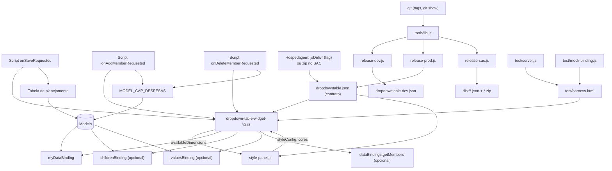

### 16.2 Funções usadas por vários fluxos (núcleo)

| Função | Usada por |
|---|---|
| `_buildRowAddrObj` | render, troca de dropdown, edição, bloqueio, save (`_buildChangedData`), `getOldRowAddrStr` |
| `_resolveDropdownOptions` | render, membro padrão, `_memberLabel` |
| `_getDefaultMember` | render, endereço, bloqueio |
| `_isNoValueAddress` | bloqueio, troca de dropdown, lista de gravação |
| `_getMeasureIdByKey` | render, troca de dropdown, lista de gravação, `clearMeasureInput` |
| `_cleanMemberId` / `_normalizeLabel` | praticamente todos |
| `_accountIndex` | criar e excluir membro |
| `_emitProperties` / `_emitEvent` | todas as saídas para o SAC |

### 16.3 Dependências externas e críticas

| Dependência | Tipo | Crítica? | Motivo |
|---|---|---|---|
| SAP Analytics Cloud (Optimized Story Experience) | Plataforma | 🔴 | Ambiente de execução e APIs. |
| Tabela de planejamento na story | Componente SAC | 🔴 | Única forma de gravar. |
| Modelo de planejamento | Dados | 🔴 | Destino da gravação. |
| `myDataBinding` | Binding | 🔴 | Sem ele a tabela fica vazia. |
| `valuesBinding` / `childrenBinding` / `getMembers` | Binding/API | 🟠 | Sem eles, valores gravados e opções caem nos fallbacks. |
| jsDelivr ou hospedagem no SAC | Distribuição | 🟠 | Arquivo indisponível ou hash diferente = widget não carrega. |
| GitHub (repositório) | Código-fonte | 🟢 | Necessário para versionar e gerar pacotes; não para executar (se hospedado no SAC). |
| Node.js 18+ | Ferramenta | 🟢 | Release e testes (usa `fetch` nativo). |
| Bibliotecas JavaScript | — | — | **Nenhuma.** |

---

## 17. Pontos Críticos

| Nível | Ponto | Motivo |
|---|---|---|
| 🔴 | **Contexto da Tabela de gravação** | O `setUserInput` só recebe as dimensões do endereço do widget; o restante (cliente, versão, data) vem do contexto da Tabela. 🔎 Se a Tabela não estiver filtrada igual ao binding, o valor vai para outro contexto ou soma. |
| 🔴 | **`_buildRowAddrObj`** | Define onde cada valor é gravado. Qualquer mudança na ordem de prioridade altera combinações gravadas. |
| 🔴 | **Dimensões do `myDataBinding`** | Adicionar/remover dimensão muda colunas, endereço obrigatório (RN-13) e dropdowns (RN-01). |
| 🔴 | **IDs técnicos e hierarquias** (`writeHierarchies`, `_resolveTechnicalId`) | Hierarquia errada → `setUserInput` falha ou grava em outro membro. O fallback `<DIM>_H1` é um palpite. |
| 🔴 | **Regras padrão fixas** (`RESPONSABILIDADE=CLIENTE`, `NÃO APLICAVEL`) | Renomear a dimensão/membro no modelo sem ajustar o painel desliga as regras silenciosamente. |
| 🔴 | **Publicação (URL + integrity)** | Hash diferente do arquivo servido = widget não carrega em produção. Nunca editar o arquivo publicado sem gerar o JSON de novo. |
| 🔴 | **`clearPendingChanges` no script** | Sem a chamada, pendências se acumulam, o Salvar fica 10s bloqueado e falhas não são sinalizadas. |
| 🟠 | **Separadores no endereço** (`\|~\|`, `\|\|\|`, `§`, `###`, `\|`) | IDs de membro contendo esses textos quebram o endereço. |
| 🟠 | **Janela pós-save (2 bindings / 15s)** | Se o SAC enviar mais bindings ou demorar mais, o refresh pode ser tratado como troca de contexto (pendências já foram limpas, então o efeito é só visual). |
| 🟠 | **Bloqueio de exclusão só no navegador** | Considera apenas o cliente/contexto atual e pode ser contornado por script; a exclusão afeta o modelo inteiro. As permissões do modelo são a proteção real. |
| 🟠 | **Heurística numérica** (`1.500` = 1500) | Entrada `10.500` vira 10500, não 10,5. |
| 🟠 | **Zeros gravados** | "Apagar" grava 0; zeros acumulam no modelo e podem afetar o desempate entre combinações. |
| 🟠 | **`getMembers` (limite 2000, sem parentId)** | Dimensões grandes ficam incompletas; nós só são excluídos se aparecerem nos bindings. |
| 🟠 | **Modo legado** | Qualquer chamada a `setDropdownDimensions`/`setRowValues`/`setDropdownOptions` muda o comportamento (bloqueios e netos deixam de valer). |
| 🟠 | **Textos do contrato divergentes do código** | `getDeleteMemberId` (retorna ID limpo), `measureChangeAddrStr` (formato real `\|~\|`), `dimensionFilter*`, hint do painel. Podem induzir erro em scripts novos. |
| 🟢 | Estilos e cores | Isolados em variáveis CSS e no painel. |
| 🟢 | Ferramentas e testes | Não afetam a execução no SAC. |

---

## 18. Troubleshooting

| Problema | Possível causa | Onde investigar | Solução |
|---|---|---|---|
| Widget não aparece / erro ao carregar | URL indisponível ou `integrity` diferente do arquivo | Console (F12) → aba Rede; `node tools/release-*.js --check` | Regerar o JSON da versão e reimportar. |
| "Identifier ... has already been declared" | PROD e DEV com código fora da IIFE (versões antigas) | Console | Usar versões ≥ v2.13 (IIFE + `?tag=`). |
| Tabela mostra "Carregando..." | `myDataBinding` sem `state: success`, sem metadata/data | Builder do widget; modo diagnóstico | Corrigir o binding. |
| "Nenhum dado disponível" | Binding vazio (filtros) | Filtros da story / Input Control | Ajustar filtros. |
| Dropdown não aparece numa dimensão | Painel marcou outras dimensões; ou story em modo legado | Painel → Dropdowns; scripts da story chamando `set*` | Marcar a dimensão / remover scripts legados. |
| Lista com "Sem opções..." | Sem `childrenBinding`, `getMembers` indisponível e nenhum membro visto | Modo diagnóstico (`getMembers: ...`) | Configurar `childrenBinding` ou `valuesBinding`. |
| Lista mostra nós/pais | Nó não aparece em nenhum binding (getMembers não traz parentId) | `_bindingNodeIds` no diagnóstico | Incluir o nível pai no binding ou usar `childrenBinding`. |
| Célula mostra "Selecionar..." em vez de NÃO APLICÁVEL | Membro padrão não existe nas opções ou campo vazio no painel | Painel → Valor inicial; opções da dimensão | Ajustar o texto (comparação ignora acento/caixa). |
| Valor gravado não aparece no dropdown | `valuesBinding` não configurado ou dimensões não estão no nível folha | Builder → valuesBinding; diagnóstico `valuesBinding` | Configurar conta + dimensões folha + medida. |
| Valor da medida aparece em dobro (ex.: 525 em vez de 262,5) | Binding sem os mesmos filtros de versão/data da story (💬 caso real) | Filtros do `myDataBinding` vs Tabela | Alinhar filtros. |
| Medidas bloqueadas | Tudo NÃO APLICÁVEL (RN-11) ou membro "não recebe valor" (RN-10) | Tooltip do input | Escolher as dimensões / revisar `noValueMembers`. |
| CLIENTE não grava 0 | Dimensão/membro com outro nome; painel com regra diferente | Painel → Gravação | Ajustar `DIM=MEMBRO`. |
| "Preenchimento obrigatório" no save | `deleteValue` vazio | Painel → Valor para apagar | Usar `0`. |
| `setUserInput` falha (linha vermelha) | Hierarquia errada, membro inexistente, sem permissão, célula bloqueada, contexto da Tabela | Diagnóstico `[DropdownTable] Gravação`; `writeHierarchies` | Corrigir hierarquia/permissões/filtros. |
| "N alterações sem todas as dimensões ficaram de fora" | Endereço incompleto (RN-13) | Diagnóstico (`ignoradasPorEnderecoIncompleto`) | Escolher todas as dimensões; checar membro padrão. |
| "Nenhuma alteração pendente" em dobro | Listeners duplicados (versões < v2.14) | Versão do JSON importado | Atualizar para v2.14.0. |
| Salvar não responde | Script não chama `clearPendingChanges` (proteção de 10s) | Script `onSaveRequested` | Incluir a chamada no final. |
| Alterações somem ao trocar o cliente | RN-18 (intencional) | Aviso amarelo / `onPendingChangesDiscarded` | Salvar antes de trocar o contexto. |
| Valor salvo "volta" após o save | Refresh fora da janela pós-save ou modelo não gravou | `clearPendingChanges`, retorno do `setUserInput` | Verificar gravação; recarregar. |
| ⚠ ao lado da conta | Mais de uma combinação com valor ≠ 0 (RN-05) | Tooltip; dados do modelo | Zerar as combinações extras. |
| Não deixa excluir conta | Tem valores no cliente atual ou subcontas (RN-24) | Mensagem do diálogo | Zerar e salvar / mover subcontas. |
| Criação de membro falha | Permissão, hierarquia, pai inexistente | Aviso do widget (`setMemberResult`) | Conferir hierarquia `Hierarquia_DESC_CONTA` e o pai. |
| Delete não apaga células selecionadas | Comportamento esperado: só dispara `onCellsDeleteRequested` | Scripts da story | Implementar o tratamento no script, se desejado. |
| Filtro por script não funciona | Binding não expõe `setDimensionFilter` | Console | Usar filtros da story/Input Control. |
| Cores do painel não mudam | Story com cores salvas antigas | Painel | Restaurar padrão SAP Horizon → Aplicar. |
| Investigação geral | — | Painel → **Modo diagnóstico**; console filtrando `[DropdownTable]` | Logs de binding, valuesBinding, getMembers, Salvar e Gravação. |

---

## 19. Manutenção

### Como realizar manutenção

| Preciso... | Onde procurar | Observação |
|---|---|---|
| Alterar uma regra de gravação | `_buildWriteList`, `_registerDropdownMove`, `_isNoValueAddress` | Atualizar testes H, I, J. |
| Alterar uma regra de bloqueio | `_getRowLockState`, `_applyRowLock` | Testes I1–I4, J1. |
| Alterar o membro padrão | Painel → Valor inicial (sem código) ou `_emptyDefaultLabel` no construtor | Testes G. |
| Alterar a regra do CLIENTE | Painel → Gravação (sem código) ou `_noValueMembers` no construtor e em `applyStyleConfig` | O padrão aparece em dois lugares do widget e no painel. |
| Adicionar um campo ao painel | `style-panel.js` (HTML do template, `COLOR_FIELDS` ou `_submit`/`set styleConfig`) + `applyStyleConfig` | Cor nova: uma linha em `COLOR_FIELDS` + variável CSS no widget (`CSS_VARS_*`). |
| Adicionar uma validação na criação de membro | `_bindModal` (handler do botão Criar) | Testes L5–L7. |
| Alterar um dropdown (opções) | `_resolveDropdownOptions`, `_loadDataSourceMembers`, ou bindings no Builder | Preferir configurar `childrenBinding` a mudar código. |
| Alterar a tabela (colunas/linhas) | Bindings no Builder; `_render`; `renderRow` | Mudar dimensões no binding afeta o endereço (RN-13). |
| Alterar uma medida | Builder (`myDataBinding`); `_getMeasureIdByKey` se o ID não resolver | Verificar `@MeasureDimension` no diagnóstico. |
| Alterar uma dimensão | Builder + painel (Dropdowns, Hierarquias, Membros sem valor) | Ver matriz de impacto. |
| Alterar uma Data Action | **Não há Data Actions no projeto.** | — |
| Alterar o fluxo de save | Script `onSaveRequested` (story) + `clearPendingChanges`/`_bindSaveButton` | Manter a ordem: `getWriteCount` → loop → `submitData` → `clearPendingChanges`. |
| Alterar a aparência | CSS do template (tokens `--sap-*`) e painel | Testes K. |
| Corrigir um erro | Ligar o modo diagnóstico, reproduzir no harness (`test/mock-binding.js`), criar teste que falha, corrigir | Rodar todos os testes e `coexist.html`. |
| Adicionar funcionalidade | Novo método: implementar no widget **e** declarar no JSON (`methods`); novo evento: `_emitEvent` + `events` no JSON | Sem declaração no JSON o SAC não enxerga. |

### Processo de publicação (resumo)
1. Branch → alteração → `node test/server.js` → harness 100% verde + `coexist.html`.
2. **DEV:** commit → `node tools/release-dev.js` → commit do JSON DEV → push → `--check` → importar no SAC (cópia da story). Alternativa hospedada no SAC: `node tools/release-sac.js <ref> --dev` → importar JSON + zip.
3. **Produção:** merge na `main` → `git tag vX.Y.Z` → push da tag → `node tools/release-prod.js vX.Y.Z --check` (ou `release-sac.js vX.Y.Z`) → importar no SAC.
4. **Rollback:** reimportar o JSON (e zip, se hospedado) da versão anterior (`releases/`).

---

## 20. Matriz de Impacto

| Alteração | Componentes impactados | Risco |
|---|---|---|
| Adicionar/remover dimensão no `myDataBinding` | `_render`, `_buildRowAddrObj`, `_buildWriteList` (endereço obrigatório), painel (Dropdowns), `valuesBinding`, Tabela de gravação | Alto |
| Renomear `RESPONSABILIDADE` ou `CLIENTE` no modelo | `_noValueMembers` (padrão), painel → Gravação, `_isNoValueAddress`, bloqueio | Alto |
| Renomear/remover o membro `NÃO APLICAVEL` | `_getDefaultMember`, endereço, bloqueio RN-11, painel → Valor inicial | Alto |
| Mudar hierarquia de uma dimensão de dropdown | `writeHierarchies` (painel), `_addrToPairs`, `_resolveTechnicalId` | Alto |
| Mudar a hierarquia de contas | Grupos/subgrupos/netos (`_render`), `createMembers` (script), lista de grupos | Alto |
| Trocar a Tabela de gravação ou seus filtros | Script `onSaveRequested`, contexto da gravação | Alto |
| Adicionar/remover medida | Colunas, `_getMeasureIdByKey`, `_registerDropdownMove`, bloqueio CLIENTE, `valuesBinding` | Médio |
| Mudar `valuesBinding` | Valor gravado (RN-03), `_savedSelections` | Médio |
| Mudar `childrenBinding` | Opções (RN-06), detecção de nós | Médio |
| Mudar o nome da instância do widget (`dropdowntable_1`) | Todos os scripts da story | Médio |
| Alterar `deleteValue` | Gravações de "apagar", bloqueio CLIENTE (texto 0) | Médio |
| Alterar `_parseLocaleNumber` | Toda edição de medida | Alto |
| Alterar separadores do endereço | `pendingChanges`, `_addrToPairs`, scripts que leem `getPendingChanges` | Alto |
| Alterar método/evento no JSON | Scripts da story; reimportação do widget | Médio |
| Alterar a tag do elemento (`DT_TAG`) | JSON (`tag`), convivência PROD/DEV | Alto |
| Alterar cores/CSS | Visual | Baixo |
| Alterar ferramentas `tools/` | Publicação (hash/URL) | Médio |

---

## 21. Guia para Novos Desenvolvedores

1. **O que é o projeto.** Um Custom Widget do SAC: uma tabela de planejamento em que cada conta é uma linha, as dimensões da linha são escolhidas em listas e as medidas são digitadas. O widget prepara tudo; a story só grava.

2. **Como ele funciona.** O SAC entrega os dados pelos bindings. O widget descobre, para cada conta, qual combinação está gravada e quais opções existem. Quando o usuário mexe, o widget guarda **alterações pendentes**. Ao salvar, o script da story pede a **lista de gravação** (`getWriteCount` / `getWrite*`) e chama `setUserInput` numa Tabela de planejamento.

3. **Componentes principais.** `dropdown-table-widget-v2.js` (tudo), `style-panel.js` (configuração), `dropdowntable.json` (o que o SAC enxerga), scripts da story (README), `tools/` (publicação), `test/` (testes).

4. **Onde começa o fluxo.** Em `onCustomWidgetAfterUpdate` → `_processDataBinding` → `_render`. Para as ações do usuário: `_selectValue` (dropdown), `_onMeasureChange` (medida), `_bindSaveButton` (Salvar).

5. **Partes mais importantes.** `_buildRowAddrObj` (onde grava), `_registerDropdownMove` (mover valores), `_buildWriteList` (o que grava), `clearPendingChanges` (pós-save), `_render` (o que aparece).

6. **Partes que exigem mais cuidado.** Endereço e hierarquias; regras padrão (CLIENTE, NÃO APLICÁVEL); troca de contexto/janela pós-save; publicação com hash.

7. **Onde realizar alterações.** Tabela da seção 19. Prefira **configuração** (painel e bindings) a código.

8. **O que não deve ser alterado sem análise de impacto.** Separadores de endereço, ordem de prioridade em `_buildRowAddrObj`, `_parseLocaleNumber`, assinatura de métodos/eventos do JSON, `DT_TAG`, ordem do script de save.

9. **Como investigar problemas.** Ligue **Modo diagnóstico** no painel e filtre o console por `[DropdownTable]`: você verá o binding, o `valuesBinding`, o `getMembers`, o que foi enviado no Salvar e a lista de gravação (inclusive o que foi ignorado). Use a tabela de Troubleshooting.

10. **Como testar alterações.**

    ```bash
    node test/server.js
    ```

    - Abra `http://127.0.0.1:5180/` → precisa mostrar "Todos os N testes passaram".
    - Abra `http://127.0.0.1:5180/coexist.html` → "PASSOU".
    - Para um caso novo, crie o cenário em `test/mock-binding.js` e o teste em `test/harness.html`.
    - Depois, valide no SAC pelo widget **DEV** numa **cópia da story** antes de promover.

---

## 22. Considerações Técnicas

- **Sem dependências:** JavaScript ES5/ES2015 (classes, template strings, `Promise`), Shadow DOM aberto, CSS custom properties. Nenhuma biblioteca externa.
- **Isolamento:** o código fica numa IIFE; a tag do elemento vem de `DT_TAG`/`?tag=`; `customElements.define` só se ainda não existir. Isso permite PROD e DEV na mesma story.
- **Segurança:** todo dado do modelo entra no DOM via `textContent`/`createTextNode`; `innerHTML` só com conteúdo fixo (ícones) ou para limpar elementos. Cores do painel entram como variáveis CSS. `?tag=` aceita só `[a-z0-9-]`. Modo diagnóstico escreve dados no console (manter desligado em produção).
- **Propriedades e eventos:** o widget emite `propertiesChanged` de forma síncrona e os eventos em microtask (`_emitEvent`), para que métodos com `body` leiam valores já atualizados.
- **Desempenho:** hash do binding em vez de cópia; caches por render (`_defaultMemberCache`, `_memberLabelIndex`, `_fallbackOptionsCache`) e por binding (`_accountIndexCache`); endereço calculado uma vez por linha.
- **Estado em memória:** pendências e seleções vivem só no navegador. Recarregar a página descarta o que não foi salvo. `pendingChanges` não é restaurado da story (RN-21).
- **Chaves de estado:** seleções usam o ID da conta (estável); medidas locais usam o `rowIndex` (🔎 estável enquanto o binding não muda; mudanças fora da janela pós-save limpam o estado).
- **Hospedagem:** jsDelivr com tag fixa (imutável) ou pacote hospedado no SAC (`release-sac.js`, URLs relativas). O GitHub Pages não é mais usado pela produção.
- **Integridade:** o hash é calculado sobre o arquivo **no git** (`git show`), porque `core.autocrlf=true` altera os bytes da cópia local.
- **Itens mantidos por compatibilidade:** binding `dataSource`, `getActiveFilters`, `clearAllFilters`, `setDropdownDimensions/Options`, `setRowValues`, `getOldRowAddrStr/getNewRowAddrStr`, detail de `onSaveRequested`, `_isPlaceholderSelection`.
- **Divergências conhecidas entre textos e código (sem impacto funcional hoje):** descrição de `getDeleteMemberId` ("ID completo", mas retorna o limpo); formato de `measureChangeAddrStr`; `dimensionFilterId/Members` "preenchidos por setDimensionFilter"; hint do painel sobre "Nenhuma marcada"; `_showSaveButton` sempre verdadeiro (não há opção para esconder o Salvar); `fontStyle`/`textDecoration` não enviados pelo painel.

---

## 23. Glossário

| Termo | Significado |
|---|---|
| **SAC** | SAP Analytics Cloud. |
| **Story** | Aplicação/relatório do SAC onde o widget é usado. |
| **Custom Widget** | Componente próprio carregado pelo SAC a partir de um JSON e de arquivos JavaScript. |
| **Contribution / contrato (JSON)** | Arquivo `dropdowntable.json` que declara propriedades, métodos, eventos, bindings e URLs. |
| **Binding (data binding)** | Ligação de dados configurada no Builder; o SAC entrega `metadata` e `data`. |
| **Feed** | Grupo de um binding (`dimensions`, `measures`); as colunas viram `dimensions_0..N` e `measures_0..N`. |
| **`dimensions_0`** | Primeira dimensão do binding principal: a conta (linha). |
| **Nó** | Membro de hierarquia que tem filhos (ex.: "Periodos"); nunca é opção nem endereço. |
| **Folha** | Membro sem filhos; é o que se grava. |
| **`#`** | Membro "não atribuído" do SAC; ignorado. |
| **ID técnico** | `[DIMENSÃO].[HIERARQUIA].&[ID]`. |
| **ID limpo** | Só o `ID` (ex.: `MENSAL`). |
| **Endereço (addrStr)** | Combinação de membros de uma linha: `DIM\|~\|MEMBRO\|\|\|...`. |
| **Combinação** | Conjunto de membros das dimensões de dropdown de uma conta. |
| **Valor gravado** | Combinação já existente no modelo para a conta (via `valuesBinding` ou `setRowValues`). |
| **Alteração pendente** | Edição ainda não salva (`_pendingChanges`). |
| **Lista de gravação** | Gravações únicas montadas por `getWriteCount` para o `setUserInput`. |
| **Valor para apagar** | `deleteValue` (padrão `0`), gravado no lugar de vazio. |
| **Membro que não recebe valor** | Membro configurado em `noValueMembers` (padrão `RESPONSABILIDADE=CLIENTE`): grava 0 e trava. |
| **NÃO APLICÁVEL** | Membro padrão de dimensões sem valor (`emptyDefaultLabel`). |
| **Modo explícito / sem script** | Dropdowns configurados pelo painel ou automáticos, sem scripts de carga. |
| **Modo legado** | Story que ainda chama `setDropdownDimensions`, `setRowValues` ou `setDropdownOptions`. |
| **Troca de contexto** | Binding com conteúdo diferente (ex.: outro cliente) fora da janela pós-save. |
| **Janela pós-save** | Até 2 bindings em 15s após `clearPendingChanges` que não contam como troca de contexto. |
| **Netos / subgrupo de netos** | Contas filhas de um subgrupo (ex.: máquinas de cartão), mostradas numa linha com seletor. |
| **SAP Horizon** | Tema visual atual do SAP Fiori (fonte 72, cores `#0070f2`, `#1d2d3e`...). |
| **SRI / integrity** | Hash SHA-256 que o SAC confere antes de executar o arquivo. |
| **jsDelivr** | CDN que serve arquivos do GitHub por commit ou tag. |
| **DEV** | Widget de teste (`dropdowntable_dev`, tags `-dev`) que convive com o de produção. |
| **Harness** | Página de testes automáticos (`test/harness.html`). |
| **Modo diagnóstico** | Opção do painel que registra logs `[DropdownTable]` no console. |

---

## Revisão final (checklist aplicado)

- **Componentes cobertos:** widget, painel, contrato, bindings (4), scripts da story (3 + eventos sem tratamento identificado), ferramentas (4), testes (4), arquivos legados da pasta pai.
- **Funções:** todas as funções com efeito de negócio estão nas seções 9.1–9.9; funções puramente visuais estão agrupadas em 9.9.
- **Regras:** RN-01 a RN-28 conferidas contra o código; cada uma aponta a função onde está.
- **Diagramas:** nomes de funções, propriedades e condições conferidos com a v2.14.0.
- **Contradições encontradas e registradas (não corrigidas, conforme solicitado):** textos do JSON (`getDeleteMemberId`, `measureChangeAddrStr`, `dimensionFilter*`) e do painel ("Nenhuma marcada"); `_showSaveButton` sem configuração; `tools/release-sac.js` ainda não versionado.
- **Não identificado no código:** nomes reais de modelo, medidas, Tabela de gravação, páginas, Data Actions, tratamento dos eventos de filtro/exclusão/Delete na story.
